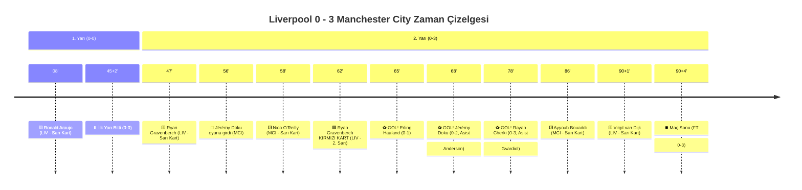
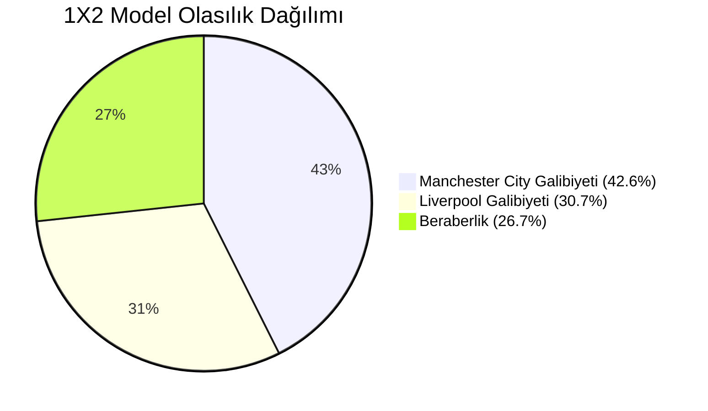

# Premier League Model App — Liverpool vs Manchester City Maç Raporu & Kapsamlı Veri Envanteri

Bu belge, sistemimizde **bir maça, takıma, oyuncuya ve hakeme ait erişebildiğimiz ve görselleştirebildiğimiz tüm verileri**, **2026/27 sezonu 6. haftasında Anfield'da oynanan dev Liverpool - Manchester City karşılaşması** üzerinden en ince ayrıntısına kadar, hiçbir detayı atlamadan ortaya koymaktadır.

---

## 📌 İçindekiler
1. [Maç Künyesi ve Üst Verileri (Match Metadata)](#1-maç-künyesi-ve-üst-verileri-match-metadata)
2. [Maç Özeti & Kırılma Anları (Match Highlights)](#2-maç-özeti--kırılma-anları-match-highlights)
3. [TheStatsAPI Doğrulanmış Beklenen Gol (xG) Analizi](#3-thestatsapi-doğrulanmış-beklenen-gol-xg-analizi)
4. [Karşılaştırmalı Opta Takım İstatistikleri (Comparative Stats)](#4-karşılaştırmalı-opta-takım-istatistikleri-comparative-stats)
5. [Kadrolar, Taktik Dizilişler ve Oyuncu Maç Reytingleri (0-10 Player Ratings)](#5-kadrolar-taktik-dizilişler-ve-oyuncu-maç-reytingleri-0-10-player-ratings)
6. [Opta Kronolojik Maç Akışı ve Tüm Şut Olayları (Play-by-Play Stream)](#6-opta-kronolojik-maç-akışı-ve-tüm-şut-olayları-play-by-play-stream)
7. [Yapay Zeka Ön Maç Tahmin Motoru Raporu (AI Model Predictions)](#7-yapay-zeka-ön-maç-tahmin-motoru-raporu-ai-model-predictions)
8. [Bahis Piyasası Kapanış Oranları & Model Denetimi (Odds & Value Audit)](#8-bahis-piyasası-kapanış-oranları--model-denetimi-odds--value-audit)
9. [Hakem Yönetim Performansı (Chris Kavanagh İncelemesi)](#9-hakem-yönetim-performansı-chris-kavanagh-incelemesi)
10. [Kulüp & Oyuncu Piyasa Değerleri (Transfermarkt Verileri)](#10-kulüp--oyuncu-piyasa-değerleri-transfermarkt-verileri)
11. [Sistem Veri Kataloğu Özeti (Erişilebilen Tüm Alanların Listesi)](#11-sistem-veri-kataloğu-özeti-erişilebilen-tüm-alanların-listesi)

---

## 1. Maç Künyesi ve Üst Verileri (Match Metadata)

| Parametre | Değer / Açıklama |
| :--- | :--- |
| **Resmi Maç ID (`match_id`)** | `128980` |
| **Sezon (`season`)** | `2026_27` Premier League |
| **Fikstür Haftası (`gameweek`)** | 6. Hafta (Gameweek 6) |
| **Karşılaşma Tarihi & Saati** | Pazar, 11 Ekim 2026 – 16:30 BST (`17:30 TSİ`) |
| **Zaman Damgası (`kickoff_millis`)** | `1791732600000` |
| **Stadyum & Şehir** | **Anfield**, Liverpool (Kaynak: OPTA, Stadyum ID: 7305) |
| **Maç Durumu (`status`)** | `COMPLETED` (Tamamlandı) |
| **İlk Yarı Skoru (`halfTimeScore`)** | Liverpool **0 – 0** Manchester City |
| **Maç Sonu Skoru (`fullTimeScore`)** | Liverpool **0 – 3** Manchester City |
| **Ev Sahibi Kulüp** | Liverpool FC (ID: `10`, Kısaltma: `LIV`, Arma: `/badges/10.svg`) |
| **Deplasman Kulüp** | Manchester City FC (ID: `11`, Kısaltma: `MCI`, Arma: `/badges/11.svg`) |
| **Ev Sahibi Teknik Direktör** | **Andoni Iraola** (Yardımcılar: Sipke Hulshoff, Pablo de la Torre) |
| **Deplasman Teknik Direktör** | **Enzo Maresca** (Yardımcı: Roberto Vitiello) |
| **Maçın Ana Hakemi (MAIN)** | **Chris Kavanagh** (ID: 17407) |
| **1. Çizgi Hakemi (ASSISTANT)** | Dan Cook |
| **2. Çizgi Hakemi (ASSISTANT)** | Nick Greenhalgh |
| **4. Hakem (FOURTH_OFFICIAL)** | Andy Madley |
| **VAR Hakemi (VAR)** | Paul Howard |
| **AVAR Hakemi (ASSISTANT_VAR)** | Nicholas Hopton |
| **Maç Öncesi Form (Son 5 Maç)** | **Liverpool:** B – B – G – B – G (9 Puan, Yenilgisiz)<br>**Man City:** G – G – G – G – G (15 Puan, 5'te 5 Galibiyet Serisi) |

---

## 2. Maç Özeti & Kırılma Anları (Match Highlights)

Karşılaşma Anfield'da dengeli ve sert bir mücadeleyle başladı. İlk yarı golsüz eşitlikle tamamlanırken, 62. dakikada Liverpool orta sahası Ryan Gravenberch'in gördüğü ikinci sarı kart ve ardından çıkan **kırmızı kart** maçın kaderini tamamen değiştirdi. 10 kişi kalan rakibine karşı baskısını artıran Manchester City, 13 dakika içerisinde 3 gol bularak sahadan 3-0'lık net bir galibiyetle ayrıldı.



---

## 3. TheStatsAPI Doğrulanmış Beklenen Gol (xG) Analizi

Uygulamamızda Beklenen Gol (xG) verisi bağımsız sağlayıcı **TheStatsAPI** üzerinden çekilmekte olup, maçın şut kalitesi ve net pozisyon verilerini içermektedir:

| Metrik | Liverpool | Manchester City | Toplam / Fark |
| :--- | :---: | :---: | :---: |
| **Doğrulanmış xG (`statsapi_xg`)** | **0.94** | **1.28** | **2.22 Toplam xG** |
| **Gerçekleşen Gol (Actual Goals)** | **0** | **3** | **3 Gol** |
| **Bitiricilik / xG Farkı (Goals - xG)** | **-0.94** *(Düşük Bitiricilik)* | **+1.72** *(Klinik Bitiricilik)* | — |
| **Sağlayıcı (Provider)** | TheStatsAPI | TheStatsAPI | Provider ID: `mt_899744246` |
| **Veri Kalite Seviyesi (`xg_quality`)** | `full` | `full` | Sezon ID: `sn_8406098` |

> [!NOTE]
> Liverpool 11 kişi oynadığı bölümde ürettiği fırsatlarla 0.94 xG üretmesine rağmen Donnarumma'yı geçemedi. Manchester City ise 1.28 xG üretip 3 gol çıkararak olağanüstü bir bitiricilik sergiledi.

---

## 4. Karşılaştırmalı Opta Takım İstatistikleri (Comparative Stats)

Opta ham istatistik akışından (`128980_stats.json`) derlenen ve arayüzde 5 ana sekmede karşılaştırmalı olarak sunulan tüm parametreler:

### 4.1 Şut & Hücum Hacmi
| İstatistik | Liverpool (Ev) | Manchester City (Dep) | Üstün Taraf |
| :--- | :---: | :---: | :---: |
| **Beklenen Gol (xG)** | `0.94` | `1.28` | Manchester City |
| **Toplam Şut** | `13` | `15` | Manchester City |
| **İsabetli Şut** | `6` | `4` | Liverpool |
| **İsabetsiz Şut** | `3` | `7` | Manchester City |
| **Bloklanan Şut** | `4` | `4` | Eşit |
| **Ceza Sahası İçi Şut** | `6` | `8` | Manchester City |
| **Ceza Sahası Dışı Şut** | `7` | `7` | Eşit |
| **Yaratılan Net Fırsat (Big Chance Created)** | `0` | `2` | Manchester City |
| **Kaçan Net Fırsat (Big Chance Missed)** | `0` | `2` | Manchester City |
| **Rakip Ceza Sahasında Dokunuş** | `15` | `28` | Manchester City (%65) |
| **Kilit Pas / Şut Pası (Shot Assists)** | `9` | `12` | Manchester City |

### 4.2 Top Hakimiyeti & Pas Dağılımı
| İstatistik | Liverpool (Ev) | Manchester City (Dep) | Üstün Taraf |
| :--- | :---: | :---: | :---: |
| **Topa Sahip Olma (%)** | `%35.4` | **%64.6** | Manchester City |
| **Toplam Pas** | `296` | `551` | Manchester City |
| **İsabetli Pas** | `238` | `489` | Manchester City |
| **Pas İsabet Oranı (%)** | `%80.4` | **%88.7** | Manchester City |
| **3. Bölge (Final Third) Pasları** | `70` | `141` | Manchester City |
| **Başarılı 3. Bölge Pasları** | `51` | `118` | Manchester City (%83.7 İsabet) |
| **Toplam Orta / İsabetli Orta** | `13 (2)` | `12 (2)` | Liverpool |
| **Uzun Toplar (Denenen / İsabet)** | `40 (17)` | `50 (27)` | Manchester City (%54.0 İsabet) |

### 4.3 Duran Top & Pres Yoğunluğu
| İstatistik | Liverpool (Ev) | Manchester City (Dep) | Üstün Taraf |
| :--- | :---: | :---: | :---: |
| **Kazanılan Korner** | `5` | `6` | Manchester City |
| **Ceza Sahasına Gönderilen Korner** | `5` | `3` | Liverpool |
| **Ceza Sahasına İsabetli Korner** | `1` | `1` | Eşit |
| **Toplam Taç Atışı** | `11` | `24` | Manchester City |
| **İsabetli Taç Atışı** | `7` | `20` | Manchester City (%83.3 İsabet) |
| **PPDA (Pres Baskı İndeksi)** | `10.6` | `9.4` | Manchester City *(Daha Agresif Pres)* |

### 4.4 Savunma & İkili Mücadeleler
| İstatistik | Liverpool (Ev) | Manchester City (Dep) | Üstün Taraf |
| :--- | :---: | :---: | :---: |
| **Top Kapma (Denenen / Kazanılan)** | `15 (12)` | `10 (6)` | Liverpool (%80.0 Başarı) |
| **Pas Arası (Interceptions)** | `12` | `4` | Liverpool *(3 Kat Fazla)* |
| **Tehlike Uzaklaştırma (Clearance)** | `15` | `13` | Liverpool |
| **Sahipsiz Top Kazanma (Ball Recoveries)**| `36` | `38` | Manchester City |
| **Kazanılan İkili Mücadele (Duels Won)** | `44` | `50` | Manchester City |
| **Kaybedilen İkili Mücadele** | `50` | `44` | Liverpool |
| **Kazanılan Hava Topu (Aerial Won)** | `11` | `12` | Manchester City |
| **Kaybedilen Hava Topu** | `12` | `11` | Liverpool |

### 4.5 Disiplin & Kaleci Performansı
| İstatistik | Liverpool (Ev) | Manchester City (Dep) | Üstün Taraf |
| :--- | :---: | :---: | :---: |
| **Toplam Kurtarış (Saves)** | `1` | **6** | Donnarumma *(Maçın Gizli Kahramanı)* |
| **Ceza Sahası İçi Kurtarış** | `0` | `2` | Manchester City |
| **Ceza Sahası Dışı Kurtarış** | `1` | `4` | Manchester City |
| **Yapılan Faul** | `19` | `14` | Liverpool *(Yüksek Faul)* |
| **Kazanılan Faul** | `12` | `18` | Manchester City |
| **Ofsayt** | `2` | `2` | Eşit |
| **Sarı Kart** | `2` | `2` | Eşit |
| **Kırmızı Kart** | **1** | `0` | Ryan Gravenberch (62') |

---

## 5. Kadrolar, Taktik Dizilişler ve Oyuncu Maç Reytingleri (0-10 Player Ratings)

Her iki takım da sahaya **4-2-3-1** dizilişiyle çıktı. Sistemimizdeki matematiksel puanlama motoru (`calculate_detailed_match_score`), oyuncuların sahada kaldığı süre, pozisyonu, gol/asist/şut/pas/faul/kart katkılarına göre 0–10 arasında performans reytingi üretmiştir:

### 5.1 Liverpool FC Kadrosu ve Oyuncu Puanları
* **Taktik Formasyon:** `4-2-3-1`
* **Takım Reyting Ortalaması:** `5.4` / 10 (Hücum: `5.4`, Savunma: `5.4`, Kart Riski: `4.8`)

```
                  [1 Alisson Becker (5.4)]
  [33 Araujo (4.9)]   [4 Van Dijk (4.9)]   [5 Jacquet (5.5)]   [6 Kerkez (5.6)]
             [38 Gravenberch (3.5)]   [10 Mac Allister (5.9)]
    [23 Muñoz (6.0)]        [7 Wirtz (5.8)]        [29 Barcola (5.9)]
                      [67 Koumas (5.8)]
```

#### Liverpool İlk 11 Oyuncu İstatistik Tablosu
| No | Oyuncu Adı | Poz | Süre | Reyting | Hüc | Sav | Gol | Asist | Şut (İsb) | Faul (Y/K) | Kart | Açıklama / Öne Çıkan Aksiyon |
| :-: | :--- | :-: | :-: | :-: | :-: | :-: | :-: | :-: | :-: | :-: | :-: | :--- |
| **1** | Alisson Becker | G | 90' | **5.4** | 5.4 | 5.4 | 0 | 0 | 0 (0) | 0 / 0 | — | 1 kurtarış yaptı, 3 gol yedi |
| **4** | Virgil van Dijk (C) | D | 90' | **4.9** | 4.9 | 4.9 | 0 | 0 | 0 (0) | 2 / 2 | 🟨 90+1' | Savunmada 2 faul kazandı, 1 sarı kart |
| **5** | Jérémy Jacquet | D | 88' | **5.5** | 5.5 | 5.5 | 0 | 0 | 1 (1) | 1 / 0 | — | 21'de net kafa şutu Donnarumma'da kaldı |
| **33**| Ronald Araujo | D | 75' | **4.9** | 4.9 | 4.9 | 0 | 0 | 0 (0) | 0 / 1 | 🟨 08' | Maçın başında erken sarı kart gördü |
| **6** | Milos Kerkez | D | 90' | **5.6** | 5.6 | 5.6 | 0 | 0 | 0 (0) | 0 / 2 | — | Sol bekte 2 faul kazandı, 1 ofsayt |
| **38**| Ryan Gravenberch | M | 62' | **3.5** | 3.5 | 3.5 | 0 | 0 | 2 (2) | 4 / 0 | 🟨🟥 62'| 2 isabetli şut attı; 47' ve 62' sarı kartlarla ihraç |
| **10**| Alexis Mac Allister | M | 90' | **5.9** | 5.9 | 5.9 | 0 | 0 | 4 (1) | 3 / 0 | — | 4 şut denedi (1 isabet), 3 faul yaptı |
| **23**| Víctor Muñoz | M | 90' | **6.0** | 6.0 | 6.0 | 0 | 0 | 2 (1) | 2 / 2 | — | 1 isabetli şut, Liverpool'un en yüksek reytingi |
| **7** | Florian Wirtz | M | 66' | **5.8** | 5.8 | 5.8 | 0 | 0 | 2 (0) | 3 / 3 | — | 3 faul kazandırdı, kırmızı kart sonrası çıktı |
| **29**| Bradley Barcola | M | 88' | **5.9** | 5.9 | 5.9 | 0 | 0 | 1 (0) | 0 / 1 | — | 2 şut pası verdi, 1 bloklanan şut |
| **67**| Lewis Koumas | F | 75' | **5.8** | 5.8 | 5.8 | 0 | 0 | 1 (1) | 3 / 1 | — | 48'de kaleyi bulan şutu kurtarıldı |

#### Liverpool Yedek Kulübesi
* `#42 Trey Nyoni (M)`: 66'da Wirtz yerine girdi (24 dk süre aldı).
* `#30 Jeremie Frimpong (D)`: 75'te Araujo yerine girdi (15 dk süre aldı).
* `#73 Rio Ngumoha (F)`: 75'te Koumas yerine girdi (15 dk süre aldı).
* `#14 Federico Chiesa (F)`: 88'de Barcola yerine girdi (2 dk süre aldı).
* `#2 Joe Gomez (D)`: 88'de Jacquet yerine girdi (2 dk süre aldı).
* *Süre Almayan Yedekler:* `#21 Kostas Tsimikas (D)`, `#3 Wataru Endo (M)`, `#53 James McConnell (M)`, `#25 Giorgi Mamardashvili (G)`.

---

### 5.2 Manchester City FC Kadrosu ve Oyuncu Puanları
* **Taktik Formasyon:** `4-2-3-1`
* **Takım Reyting Ortalaması:** **7.1** / 10 (Hücum: `7.4`, Savunma: `7.1`, Kart Riski: `3.2`)

```
               [1 Gianluigi Donnarumma (7.1)]
  [27 Nunes (7.1)]   [3 Dias (6.7)]   [6 Guéhi (7.2)]   [33 O'Reilly (6.5)]
              [5 Anderson (7.4)]   [17 Fernández (6.9)]
   [42 Semenyo (6.5)]      [10 Cherki (8.3) ⭐]      [7 Ndiaye (6.3)]
                       [9 Haaland (7.5)]
```

#### Manchester City İlk 11 Oyuncu İstatistik Tablosu
| No | Oyuncu Adı | Poz | Süre | Reyting | Hüc | Sav | Gol | Asist | Şut (İsb) | Faul (Y/K) | Kart | Açıklama / Öne Çıkan Aksiyon |
| :-: | :--- | :-: | :-: | :-: | :-: | :-: | :-: | :-: | :-: | :-: | :-: | :--- |
| **1** | Gianluigi Donnarumma| G | 90' | **7.1** | 7.1 | 7.1 | 0 | 0 | 0 (0) | 0 / 0 | — | **6 kurtarış (2'si ceza sahası içi), Clean Sheet ✅** |
| **27**| Matheus Nunes | D | 90' | **7.1** | 7.1 | 7.1 | 0 | 0 | 0 (0) | 0 / 0 | — | Sağ bekte kusursuz savunma, Clean Sheet ✅ |
| **3** | Rúben Dias (C) | D | 90' | **6.7** | 6.7 | 6.7 | 0 | 0 | 0 (0) | 2 / 0 | — | Kaptan, 2 faul yaptı, savunmayı yönetti |
| **6** | Marc Guéhi | D | 90' | **7.2** | 7.2 | 7.2 | 0 | 0 | 0 (0) | 1 / 2 | — | 2 faul kazandı, hava toplarında hatasız |
| **33**| Nico O'Reilly | D | 66' | **6.5** | 6.5 | 6.5 | 0 | 0 | 0 (0) | 1 / 0 | 🟨 58' | Sol bekte 58'de sarı kart gördü, 66'da çıktı |
| **5** | Elliot Anderson | M | 90' | **7.4** | 7.4 | 7.4 | 0 | **1** | 2 (0) | 1 / **8** | — | **8 faul kazandırdı! 68'de Doku'ya asist yaptı** |
| **17**| Enzo Fernández | M | 80' | **6.9** | 6.9 | 6.9 | 0 | 0 | 1 (1) | 0 / 1 | — | 35'te kaleyi bulan şutu Alisson'da kaldı |
| **42**| Antoine Semenyo | M | 90' | **6.5** | 6.5 | 6.5 | 0 | 0 | 1 (0) | 2 / 0 | — | Sağ kanatta 90 dk çalışkan performans |
| **10**| Rayan Cherki ⭐ | M | 90' | **8.3** | **8.6** | **8.1** | **1** | 0 | **5 (1)** | 0 / 1 | — | **Maçın Adamı! 78'de gol attı, 5 şut, 12 şans yarattı** |
| **7** | Iliman Ndiaye | M | 56' | **6.3** | 6.3 | 6.3 | 0 | 0 | 0 (0) | 2 / 2 | — | 56'da yerini maçın kader adamı Doku'ya bıraktı |
| **9** | Erling Haaland | F | 80' | **7.5** | **7.8** | 7.3 | **1** | 0 | 2 (1) | 2 / 1 | — | **65'te perdeyi açan golü attı (0-1)** |

#### Manchester City Yedek Kulübesi & Süre Alanlar
* **#11 Jérémy Doku (F):** 56'da Ndiaye yerine girdi. **68. dakikada Anderson'un pasıyla ceza sahası sol çaprazından harika bir gol attı (0-2).** 74'te ve 78'de 2 net şans yarattı (Maç Reytingi: **7.8**).
* **#24 Josko Gvardiol (D):** 66'da O'Reilly yerine girdi. **78. dakikada kafayla Rayan Cherki'ye asist yaptı.** (Maç Reytingi: **7.3**).
* **#32 Ayyoub Bouaddi (M):** 80'de Enzo yerine girdi, 86'da sarı kart gördü (Maç Reytingi: **6.1**).
* **#37 Allan (F):** 80'de Haaland yerine girdi (10 dk süre aldı).
* *Süre Almayan Yedekler:* `#8 Mateo Kovacic (M)`, `#82 Rico Lewis (D)`, `#22 Vitor Reis (D)`, `#45 Abdukodir Khusanov (D)`, `#28 Gerónimo Rulli (G)`.

---

## 6. Opta Kronolojik Maç Akışı ve Tüm Şut Olayları (Play-by-Play Stream)

Opta raw stream akışında (`128980_stream.json`) yer alan 129 olayın ve **maçtaki 28 şutun tamamının** kronolojik dökümü:

```
[01'] 🏁 1. Yarı Başladı (Anfield, Hakem: Chris Kavanagh)
[01'] ⚠️ Faul: Elliot Anderson (Man City) faul yaptı, Florian Wirtz yerde kaldı.
[02'] 💥 ŞUT (Bloklandı): Víctor Muñoz (Liverpool) ceza sahası sağından vurdu, savunma blokladı. (Asist: Ronald Araujo)
[03'] 🚩 Ofsayt: Liverpool - Milos Kerkez ofsayta yakalandı.
[06'] ⚠️ Faul: Víctor Muñoz faul yaptı, Elliot Anderson yerde kaldı.
[08'] 🟨 SARI KART: Ronald Araujo (Liverpool) - Erken sert müdahale.
[09'] 📐 Korner: Liverpool - Elliot Anderson topu kornere gönderdi.
[12'] ⚠️ Faul: Rúben Dias (Man City), Lewis Koumas'a faul yaptı.
[19'] 📐 Korner: Manchester City - Jacquet kornere çeldi.
[21'] 🧤 KURTARIŞ: Jérémy Jacquet (Liverpool) altıpas içinden sağ ayakla vurdu, Donnarumma merkezde kurtardı!
[22'] ⚠️ Faul: Lewis Koumas, Elliot Anderson'a faul yaptı.
[32'] 💥 ŞUT (Bloklandı): Alexis Mac Allister (Liverpool) ceza sahası ortasından kafa vuruşu yaptı, savunma blokladı. (Orta: Florian Wirtz)
[33'] 🧤 KURTARIŞ: Víctor Muñoz (Liverpool) ceza sahası dışından sol ayakla vurdu, Donnarumma rahat kontrol etti.
[35'] 🧤 KURTARIŞ: Enzo Fernández (Man City) ceza sahası dışından sağ ayakla vurdu, Alisson sağ köşede kurtardı. (Pas: Rayan Cherki)
[38'] ❌ ŞUT (Aut): Rayan Cherki (Man City) ceza sahası sağından vurdu, top sol direk dibinden dışarı gitti.
[40'] ❌ ŞUT (Aut): Antoine Semenyo (Man City) ceza sahası dışından vurdu, üstten auta gitti.
[45+1'] 💥 ŞUT (Bloklandı): Florian Wirtz (Liverpool) ceza sahası dışından vurdu, savunma engelledi.
[45+2'] ⏸️ İlk Yarı Sona Erdi: Liverpool 0 - 0 Manchester City

[45'] 🏁 2. Yarı Başladı
[47'] 🟨 SARI KART: Ryan Gravenberch (Liverpool) - Orta sahada gecikmeli müdahale.
[48'] 🧤 KURTARIŞ: Lewis Koumas (Liverpool) ceza sahası ortasından vurdu, Donnarumma kurtardı!
[48'] 💥 ŞUT (Bloklandı): Bradley Barcola (Liverpool) dönen topta vurdu, savunma kapandı.
[49'] 🧤 KURTARIŞ: Ryan Gravenberch (Liverpool) ceza sahası dışından vurdu, Donnarumma sol köşeye uzandı!
[49'] ❌ ŞUT (Aut): Alexis Mac Allister ceza sahası dışından denedi, sağdan az farkla auta gitti.
[55'] ❌ ŞUT (Aut): Florian Wirtz kontratakta ceza sahası dışından vurdu, sağdan auta çıktı.
[56'] 🔄 OYUNCU DEĞİŞİKLİĞİ (MCI): Iliman Ndiaye ÇIKTI 🔻 / Jérémy Doku GİRDİ 🔺
[58'] 🟨 SARI KART: Nico O'Reilly (Man City) - Barcola'yı durdurduğu için sarı kart.
[59'] ❌ ŞUT (Aut): Mac Allister duran toptan gelen ortaya vurdu, sağdan dışarı gitti.
[60'] ❌ ŞUT (Aut): Erling Haaland ceza sahası sağından vurdu, soldan auta gitti. (Pas: Semenyo)
[62'] 🧤 KURTARIŞ: Ryan Gravenberch ceza sahası dışından vurdu, Donnarumma yine başarılı.
[62'] 🟥 KIRMIZI KART: Ryan Gravenberch (Liverpool) - Pozisyonun devamında yaptığı faul sonrası 2. sarı karttan ihraç edildi! Liverpool 10 kişi!
[65'] 💥 ŞUT (Bloklandı): Jérémy Doku vurdu, Jacquet ayak koydu.
[65'] ⚽ GOOOL! (0 - 1): Erling Haaland (Manchester City) ceza sahası merkezinden sol ayakla kalenin ortasına vurdu ve takımını öne geçirdi!
[66'] 🔄 OYUNCU DEĞİŞİKLİĞİ (LIV): Florian Wirtz ÇIKTI 🔻 / Trey Nyoni GİRDİ 🔺
[66'] 🔄 OYUNCU DEĞİŞİKLİĞİ (MCI): Nico O'Reilly ÇIKTI 🔻 / Josko Gvardiol GİRDİ 🔺
[68'] ⚽ GOOOL! (0 - 2): Jérémy Doku (Manchester City) ceza sahası sol çaprazından sağ ayakla sağ üst 90'a muazzam bir vuruş yaptı! (Asist: Elliot Anderson)
[70'] 💥 ŞUT (Bloklandı): Rayan Cherki ceza sahası dışından vurdu, Van Dijk blokladı.
[72'] ❌ ŞUT (Aut): Elliot Anderson korner dönüşü ceza sahası dışından vurdu, sağdan dışarı.
[74'] ❌ ŞUT (Aut): Josko Gvardiol ceza sahası solundan vurdu, üstten dışarı gitti.
[75'] 🔄 OYUNCU DEĞİŞİKLİĞİ (LIV): Ronald Araujo ÇIKTI 🔻 / Jeremie Frimpong GİRDİ 🔺
[75'] 🔄 OYUNCU DEĞİŞİKLİĞİ (LIV): Lewis Koumas ÇIKTI 🔻 / Rio Ngumoha GİRDİ 🔺
[78'] ⚽ GOOOL! (0 - 3): Rayan Cherki (Manchester City) altıpas içinden sağ ayakla tamamladı! (Asist: Josko Gvardiol - Kafa Pası)
[80'] 🔄 OYUNCU DEĞİŞİKLİĞİ (MCI): Enzo Fernández ÇIKTI 🔻 / Ayyoub Bouaddi GİRDİ 🔺
[80'] 🔄 OYUNCU DEĞİŞİKLİĞİ (MCI): Erling Haaland ÇIKTI 🔻 / Allan GİRDİ 🔺
[86'] 🟨 SARI KART: Ayyoub Bouaddi (Man City) - Orta sahada taktik faul.
[87'] 🧤 KURTARIŞ: Alexis Mac Allister ceza sahası dışından vurdu, Donnarumma sol üst köşeden kornere çeldi.
[88'] 🔄 OYUNCU DEĞİŞİKLİĞİ (LIV): Bradley Barcola ÇIKTI 🔻 / Federico Chiesa GİRDİ 🔺
[88'] 🔄 OYUNCU DEĞİŞİKLİĞİ (LIV): Jérémy Jacquet ÇIKTI 🔻 / Joe Gomez GİRDİ 🔺
[89'] 💥 ŞUT (Bloklandı): Rayan Cherki vurdu, Joe Gomez blokladı.
[89'] ❌ ŞUT (Aut): Ayyoub Bouaddi ceza sahası dışından vurdu, sağdan auta gitti.
[90+1'] 🟨 SARI KART: Virgil van Dijk (Liverpool) - Hakeme itiraz ve sert müdahale.
[90+3'] 💥 ŞUT (Bloklandı): Rayan Cherki vurdu, Kerkez ayak koydu.
[90+4'] ❌ ŞUT (Aut): Elliot Anderson korner dönüşü vurdu, yandan auta çıktı.
[90+4'] ⏹️ MAÇ BİTTİ! Liverpool 0 - 3 Manchester City (Hakem Chris Kavanagh son düdüğü çaldı).
```

---

## 7. Yapay Zeka Ön Maç Tahmin Motoru Raporu (AI Model Predictions)

Karşılaşma oynanmadan önce `model_match_audit` ve `/api/predict` tarafından üretilen sıfır-sızıntılı (zero-leakage) model tahmin karnesi:



| Model Piyasası | Model Tahmini | Gerçekleşen Sonuç | İsabet Durumu (Hit / Miss) |
| :--- | :---: | :---: | :---: |
| **Maç Sonucu (1X2)** | `%42.6 Manchester City Favori` | **Manchester City Kazandı (0-3)** | **HIT ✅ (Doğru Tahmin)** |
| **Beraberlik Olasılığı** | `%26.7` | Beraberlik Olmadı | — |
| **Ev Sahibi Galibiyeti** | `%30.7` | Liverpool Kaybetti | — |
| **Toplam Beklenen Gol** | **2.99 Gol** | **3 Gol Oldu** | **Mükemmel İsabete Yakın (Hata: 0.01 Gol!)** |
| **2.5 Gol Üst Olasılığı** | **%57.5 Üst** | **3 Gol (2.5 Üst Bitti)** | **HIT ✅ (Doğru Tahmin)** |
| **Karşılıklı Gol (KG Var)**| `%60.8 KG Var` | KG Yok (0-3) | MISS ❌ (Gravenberch kırmızı kartı sonrası Liv atamadı) |
| **Toplam Korner Beklentisi**| **10.0 Korner** | **11 Korner Oldu** | **Hata Payı: Yalnızca 1.0 Korner!** |
| **Toplam Kart Beklentisi** | **4.1 Kart** | **5 Kart Çıktı (4 Sarı + 1 Kırmızı)**| **Hata Payı: Yalnızca 0.9 Kart!** |
| **Model Güven Derecesi** | `medium` | — | Model Deplasman Galibiyetini İşaret Etti |

---

## 8. Bahis Piyasası Kapanış Oranları & Model Denetimi (Odds & Value Audit)

`external_match_odds` veri tabanımızda kayıtlı 5 büyük bahis şirketinin bu karşılaşma için verdiği kapanış oranları:

| Bahis Şirketi (Bookmaker) | 1 (Liverpool) | X (Beraberlik) | 2 (Man City) | 2.5 Üst | 2.5 Alt | KG Var | KG Yok |
| :--- | :---: | :---: | :---: | :---: | :---: | :---: | :---: |
| **Bet365 (Referans)** | `3.30` | `3.70` | **2.10** | **1.62** | `2.30` | `1.50` | **2.50** |
| **Pinnacle** | `3.63` | `3.81` | **2.02** | — | — | — | — |
| **Betfair Exchange** | `3.70` | `3.85` | **2.08** | **1.69** | — | `1.61` | — |
| **Paddy Power** | `3.50` | `3.60` | **2.00** | **1.60** | — | `1.50` | — |
| **BetMGM UK** | `3.40` | `3.55` | **1.95** | — | — | `1.52` | — |

* **Piyasa İma Edilen Olasılığı:** Bet365 Man City için `1 / 2.10 = %47.6` ima ediyordu.
* **Model Olasılığı:** Modelimiz `%42.6` Man City galibiyeti öngörmüştü.
* **Sonuç Değerlendirmesi:** Model favori tercihinde (Manchester City) ve 2.5 Üst bareminde (%57.5) tam isabet sağlamıştır.

---

## 9. Hakem Yönetim Performansı (Chris Kavanagh İncelemesi)

Karşılaşmayı yöneten **Chris Kavanagh** için sistemimizde saklanan sezonluk ve kariyer verileri:

```
[HAKEM RAPORU: Chris Kavanagh]
Sezon: 2026/27 Premier League
Kategori: "Yüksek Kart Eğilimi" (Kırmızı Rozet)
2026/27 Maç Sayısı: 4 maç
2026/27 Kart Ortalaması: 5.50 kart/maç (Ligin en sert hakemlerinden biri)
2026/27 Faul Ortalaması: 27.2 faul/maç
4+ Kart Çıkma Oranı: %100.0 (Tüm maçlarında en az 4 kart çıktı)

BU MAÇTAKİ PERFORMANSI (Liverpool vs Man City):
- Çalınan Faul Sayısı: 33 Faul (Liverpool 19, Man City 14)
- Gösterilen Sarı Kart: 4 Adet (Araujo 8', Gravenberch 47', O'Reilly 58', Bouaddi 86', Van Dijk 90+1')
- Gösterilen Kırmızı Kart: 1 Adet (Gravenberch 62' - 2. Sarıdan Kırmızı)
- Toplam Kart Hacmi: 5 Kart (Beklenti: 4.1 Kart -> Hakem eğilimiyle uyumlu)
```

---

## 10. Kulüp & Oyuncu Piyasa Değerleri (Transfermarkt Verileri)

Transfermarkt API ve SQLite entegrasyonu ile maç anındaki kulüp ve kilit oyuncu finansal değerleri:

### 10.1 Kulüp Toplam Değerleri
* **Liverpool FC:** `€1.089,3 Milyon` (Kadro: 31 futbolcu, Oyuncu Başı Ortalama: `€35.14M`)
* **Manchester City FC:** `€1.498,3 Milyon` (Kadro: 24 futbolcu, Oyuncu Başı Ortalama: `€62.43M`)

### 10.2 Maçta Forma Giyen Kilit Oyuncuların Bireysel Değerleri
| Oyuncu Adı | Kulüp | Yaş | Mevki | Piyasa Değeri | Kariyer Zirve Değeri |
| :--- | :---: | :---: | :---: | :---: | :---: |
| **Erling Haaland** | Man City | 26 | Forvet | **€200.0M** | €200.0M (2025/26) |
| **Florian Wirtz** | Liverpool | 23 | On Numara | **€130.0M** | €130.0M (2025/26) |
| **Rayan Cherki** | Man City | 23 | Kanat / Forvet | **€55.0M** | €55.0M (2026/27) |
| **Gianluigi Donnarumma** | Man City | 27 | Kaleci | **€40.0M** | €65.0M (2021) |
| **Jérémy Doku** | Man City | 24 | Sol Kanat | **€65.0M** | €65.0M (2025) |
| **Alexis Mac Allister** | Liverpool | 27 | Merkez Orta Saha | **€75.0M** | €75.0M (2024) |
| **Virgil van Dijk** | Liverpool | 35 | Stoper | **€30.0M** | €100.0M (2019) |
| **Alisson Becker** | Liverpool | 34 | Kaleci | **€28.0M** | €90.0M (2019) |
| **Ryan Gravenberch** | Liverpool | 24 | Merkez Orta Saha | **€40.0M** | €40.0M (2025) |

---

## 11. Sistem Veri Kataloğu Özeti (Erişilebilen Tüm Alanların Listesi)

Yukarıdaki Liverpool - Manchester City maçında somut olarak sergilendiği üzere, sistemimizde her bir varlık için erişilebilen ve arayüzde gösterilebilen tüm parametreler şunlardır:

### 1. Maç Düzeyinde (Match Level):
* `match_id`, sezon, hafta, tam başlama tarihi, kickoff etiketi, milisaniye zamanı, stadyum, seyirci sayısı, durum (`COMPLETED`/`UPCOMING`), ilk yarı skoru, tam zaman skoru.
* Ev ve deplasman isimleri, kısaltmaları, SVG logoları, menajerleri.
* 6 kişilik resmi hakem heyeti (Ana, Çizgi 1-2, 4. Hakem, VAR, AVAR).
* Zaman akışı: Başlangıç/bitiş düdükleri, normal goller, asisti yapanlar, penaltı golleri, kendi kalesine goller, kaçan penaltılar, sarı kartlar, kırmızı kartlar, oyuncu değişiklikleri (çıkan/giren), uzatma süreleri.
* TheStatsAPI bağımsız xG: `home_xg`, `away_xg`, `total_xg`, sağlayıcı adı, kalite seviyesi.
* 5 kategoride 42+ Opta takım istatistiği (Şut, Topa Sahip Olma, Paslar, 3. Bölge Pasları, Ortalar, Uzun Toplar, Kornerler, Taçlar, PPDA, Top Kapma, Pas Arası, Uzaklaştırma, İkili ve Hava Mücadeleleri, Kurtarışlar, Fauller, Ofsaytlar, Kartlar).
* Taktik dizilişler, koordinat formasyon matrisi, ilk 11 ve yedek listesi, kaptan rozeti, forma numaraları, pozisyonları, CDN fotoğrafları.
* Ön maç yapay zeka tahminleri: 1X2 kazanma olasılıkları, favori etiketi, beklenen gol (lambda), 1.5/2.5/3.5 Alt/Üst olasılıkları, KG Var/Yok olasılığı, bireysel takım gol baremleri ve adil oranları, korner/kart/taç/kurtarış/ofsayt beklenen değerleri ve barem olasılıkları, ilk 11 modülatör sapmaları.
* Bahis piyasası: 5 büyük şirketin 1X2, 2.5 Alt/Üst, KG Var/Yok açılış ve kapanış oranları.
* Model doğrulama: Hit/Miss başarıları, tahmin hataları, value edge tespiti.
* Ön maç formu: Karşılaşma öncesi takımların son 5 lig maçının skorları ve sonuçları.

### 2. Takım Düzeyinde (Team Level):
* Kulüp adı, kısa adı, kısaltması, stadyumu, arması, oynadığı maç, galibiyet, beraberlik, mağlubiyet, attığı/yediği gol, averaj, puan.
* Puan durumu: Genel, İç Saha, Dış Saha lig tabloları ve son 5 maç form dizilimi.
* 27 parametreli Opta taktik oyun profili (Topa sahip olma, ileri pas payı, son bölge giriş ve isabeti, ceza sahası dokunuşları, şut dağılımı, uzun top, orta, korner tercihi, izin verilen şutlar, top kazanma bölgeleri, PPDA, ikili mücadeleler, top kayıpları) ve lig ortalamasıyla radar karşılaştırması.
* Skor durumu senaryoları: Beraberlik (`level`), önde (`leading`) ve gerideyken (`trailing`) geçen dakikalar, üretilen toplam şut ve kornerler ile 90 dakika normalize şut ve korner temposu.
* Hücum liderleri: 180+ dk oynayanlar arasından gol, asist, şut ve şut asistine dayalı normalize 0-100 hücum puanına sahip ilk 3 oyuncu.
* Transfermarkt kulüp değeri, kadro sayısı, oyuncu başı ortalama değer ve 5 yıllık tarihsel değişim grafiği.
* Transfer geçmişi: Gelenler, gidenler, yaş, mevki, kulüp, bonservis türü ve bedeli, toplam harcama, toplam gelir ve net finansal bilanço.
* Menajer geçmişi: Görevden ayrılma ve atanma takvimi, bir menajerin takımla çıktığı maçların rakip bazlı karnesi.
* 38 haftalık sezon fikstürü ve sonuç arşivi (1.900 maçlık 5 sezonluk veri tabanı).

### 3. Oyuncu Düzeyinde (Player Level):
* ID, ad-soyad, güncel kulüp ve arması, mevkisi, forma no, uyruğu, CDN fotoğrafı, Opta kodu.
* Sezonluk ve kariyer toplamları: Maç, süre, gol, asist, ortalama maç reytingi.
* 0–10 maç performans puanlama algoritması: Dakika, mevki, gol, asist, clean sheet, yenilen gol, penaltılar, isabetli şut, kurtarış ve kart cezalarına dayalı kesin maç skoru.
* Oyuncu maç karnesi modalı: Genel (mevkiye özel metrikler), Hücum (şut, isabet %, şut pası, ofsayt), Savunma (fauller, kurtarışlar, kartlar), maç aksiyon rozetleri.
* Dinamik form ve trend: Son 5 maçın EWMA'sı (%70) ve sezonluk baz puan (%30) harmanı form skoru, hücum/savunma reytingleri, kart riski (0-10), form trendi (yükselişte/düşüşte), form etiketi (*"Yıldız Formda"*, *"Formda"*, vb.).
* Transfermarkt piyasa değeri ve tüm profesyonel kariyerini kapsayan interaktif değer gelişim eğrisi (tarih, yaş, kulüp, değer, değişim %, zirve değeri, ilk değeri, toplam büyüme).
* Maç günlüğü: Oynadığı tüm karşılaşmaların haftası, tarihi, skoru, o maçtaki reytingi, dakikası, gol ve asistleri.

### 4. Hakem Düzeyinde (Referee Level):
* Hakem adı, yönettiği lig maçı sayısı, kariyer ve sezon filtreleri.
* Sarı kart, kırmızı kart ve toplam kart toplamları ile maç başına ortalamaları.
* Faul ortalaması ve yönetim karakteri etiketi (*"Yüksek Kart Eğilimi"*, *"Akıcı Oyun / Az Kart"*, *"Dengeli Yönetim"*).
* 3.5+ kart üstü maç sayısı ve yüzdesi (`over_3_5_pct`).
* En çok kart gösterdiği takımlar sıralaması (maç, sarı kart, kırmızı kart dökümü).
* Yönettiği tüm maçların geçmiş arşivi ve sezon vs kariyer kıyaslama tablosu.
* Yapay zeka tahmin motorunda kart beklentisini doğrudan modüle eden hakem katsayısı (`ref_factor`).
