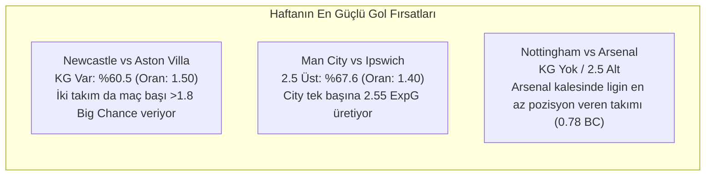

# Premier League 7. Hafta (Gameweek 7) Kapsamlı Model Tahmin ve İddaa Analiz Raporu

**Tarih:** 16 Ekim 2026  
**Kapsam:** Premier League 2026/27 Sezonu 7. Hafta (17 - 19 Ekim 2026) 10 Karşılaşması  
**Model Mimarisi:** 55 Özellikli Bivariate Poisson Hibrit Modeli (%25 Dixon-Coles + %75 Feature Poisson, $\alpha=10.0$) & Düzenlileştirilmiş 1X2 Topluluk Modeli  
**Veri Kaynakları:** `data/processed/features_matches_all.parquet`, TheStatsAPI Canlı Piyasa Oranları (Bet365 / Pinnacle)

---

## 1. Yönetici Özeti ve Hafta Genel Bakışı

Premier League 2026/27 sezonunda geride kalan 6 haftada (60 maç) modelimiz **KG Var pazarında %66.7 (40/60)**, **2.5 Üst pazarında %58.3 (35/60)** ve **Net Favori 1X2 tercihlerinde %72.0 (18/25)** isabet kaydetmiştir. 

7. Hafta programında yer alan 10 karşılaşma, modelin güven düzeyine ve piyasa oranları ile model olasılıkları arasındaki matematiksel farka (Edge / Değer) göre 3 ana kategoriye ayrılmıştır:

```
┌────────────────────────────────────────────────────────────────────────────────────────┐
│  7. HAFTA GÜVEN DÜZEYİ DAĞILIMI                                                        │
├────────────────────────────────┬───────────────────────┬───────────────────────────────┤
│  🟢 KESİN EMİN OLDUĞU (HIGH)   │ 🟡 ORTA GÜVEN (MEDIUM)│ 🔴 ÇEKİNGEN / DENGELİ (BAL)   │
│  • Man City vs Ipswich (%71.6) │ • Fulham vs Hull City │ • Everton vs Chelsea (Gri)    │
│  • Not. Forest vs Arsenal (%60)│ • Newcastle vs A.Villa│ • Brentford vs Liverpool (Gri)│
│  • Tottenham vs Coventry (%55) │ • Bournemouth vs Sund.│ • Leeds Utd vs Man Utd (Gri)  │
│  • Brighton vs C.Palace (%52)  │                       │                               │
└────────────────────────────────┴───────────────────────┴───────────────────────────────┘
```

---

## 2. 7. Hafta Maç Özeti & Olasılık Tablosu

| Maç | Tarih & Saat | Model 1X2 (%) | Favori & Güven | Gol Beklentisi | 2.5 Üst (%) | KG Var (%) | Korner / Kart | Piyasa 1X2 Oranları | En Yüksek Değer (Edge) |
| :--- | :---: | :---: | :---: | :---: | :---: | :---: | :---: | :---: | :---: |
| **Everton - Chelsea** | 17 Eki 14:30 | `35.5 - 29.5 - 35.0` | Everton (Dengeli) | `1.52 - 1.34 (2.86)` | `%54.5` | `%58.4` | `10.5 / 4.1` | `3.10 - 3.80 - 2.15` | Everton 1X (+3.2% Edge) |
| **Brentford - Liverpool** | 17 Eki 17:00 | `33.3 - 36.7 - 29.9` | Beraberlik (Dengeli) | `1.56 - 1.39 (2.94)` | `%56.4` | `%59.9` | `10.0 / 4.3` | `2.40 - 3.75 - 2.70` | **Beraberlik (+10.0% Edge)** |
| **Fulham - Hull City** | 17 Eki 17:00 | `46.3 - 21.9 - 31.8` | Fulham (Medium) | `1.46 - 1.26 (2.73)` | `%51.3` | `%55.9` | `10.6 / 3.8` | `1.73 - 3.90 - 4.50` | Hull City Sürpriz (+9.6%) |
| **Man City - Ipswich Town** | 17 Eki 17:00 | **`71.6 - 22.3 - 6.2`** | **Man City (High)** | **`2.55 - 0.93 (3.48)`** | **`%67.6`** | `%56.4` | `10.7 / 3.7` | `1.25 - 6.50 - 9.50` | **2.5 Üst & City Kazanır** |
| **Newcastle - Aston Villa** | 17 Eki 19:30 | `46.1 - 24.9 - 29.1` | Newcastle (Medium) | `1.65 - 1.35 (3.00)` | `%57.6` | **`%60.5`** | `10.0 / 4.2` | `2.25 - 3.60 - 3.00` | **KG Var (%60.5)** |
| **Bournemouth - Sunderland** | 18 Eki 16:00 | `44.9 - 27.7 - 27.3` | Bournemouth (Med) | `1.52 - 1.26 (2.78)` | `%52.6` | `%56.7` | `10.2 / 4.4` | `2.10 - 3.40 - 3.60` | 2.5 Üst (1.91) |
| **Brighton - Crystal Palace** | 18 Eki 16:00 | **`51.7 - 32.5 - 15.8`** | **Brighton (High)** | **`2.02 - 1.10 (3.13)`** | **`%60.4`** | `%58.6` | `10.7 / 3.8` | `1.50 - 4.50 - 5.75` | **Brighton Kazanır & 2.5 Üst** |
| **Leeds Utd - Man United** | 18 Eki 16:00 | `31.0 - 34.2 - 34.8` | Man Utd (Dengeli) | `1.43 - 1.41 (2.84)` | `%54.0` | `%58.2` | `10.2 / 4.4` | `2.30 - 3.60 - 2.90` | **Beraberlik (+6.4% Edge)** |
| **Not. Forest - Arsenal** | 18 Eki 18:30 | **`12.3 - 27.9 - 59.9`** | **Arsenal (High)** | `1.13 - 1.58 (2.71)` | `%50.8` | `%54.4` | `9.7 / 4.4` | `5.75 - 3.90 - 1.62` | **Arsenal Kazanır** |
| **Tottenham - Coventry City** | 19 Eki 22:00 | **`55.2 - 21.5 - 23.4`** | **Tottenham (High)** | `1.69 - 1.13 (2.82)` | `%53.6` | `%56.0` | `10.8 / 4.2` | `1.45 - 4.50 - 7.00` | **Tottenham Kazanır** |

---

## 3. Modelin "Çok Confident" (Yüksek Güvenli) Olduğu Karşılaşmalar

Bu kümedeki maçlar, modelin kazanma olasılığını `%50`'nin üzerinde gördüğü, kadro güç endekslerinin ve ilk 11 reytinglerinin tek taraflı ağır bastığı maçlardır:

### 1. Manchester City vs Ipswich Town
* **Model Tahmini:** Ev Sahibi Kazanır (%71.6) | 2.5 Gol Üstü (%67.6)
* **Gol Beklentisi:** 2.55 - 0.93 (Toplam: 3.48 gol)
* **Taktiksel Röntgen:**
  - Manchester City İlk 11 Hücum gücü ile Ipswich savunma hattı arasındaki net fark **+3.48** seviyesinde (Haftanın en asimetrik eşleşmesi).
  - Ipswich Town son 10 maçında ortalama **2.20 net pozisyon (big chances conceded)** veriyor. 
  - City iç sahada maç başına 2.85 xG üretiyor.
* **Bahis Değerlendirmesi:** Haftanın en net bankosu. Kombin kuponlar için **Man City Galibiyeti (1.25)** ve **2.5 Üst (1.40)** birincil tercih.

### 2. Nottingham Forest vs Arsenal
* **Model Tahmini:** Deplasman Kazanır (%59.9) | 2.5 Alt Yatkınlığı (%49.2)
* **Gol Beklentisi:** 1.13 - 1.58 (Toplam: 2.71 gol)
* **Taktiksel Röntgen:**
  - Arsenal, ligin kalesinde en az büyük pozisyon veren takımı (son 10 maçta ortalama sadece **0.78 big chances against**).
  - Nottingham Forest hücumcularının güncel reytingi, Arsenal'in Gabriel-Saliba merkez hattına karşı **-1.92** negatif marjda kalıyor.
  - Model, Forest'ın sürpriz yapma ihtimalini yalnızca **%12.3** olarak hesaplıyor.
* **Bahis Değerlendirmesi:** **Arsenal Galibiyeti (1.62)** piyasada son derece dolgun ve güvenli bir liman.

### 3. Brighton & Hove Albion vs Crystal Palace
* **Model Tahmini:** Ev Sahibi Kazanır (%51.7) | 2.5 Gol Üstü (%60.4)
* **Gol Beklentisi:** 2.02 - 1.10 (Toplam: 3.13 gol)
* **Taktiksel Röntgen:**
  - Brighton iç sahada yüksek presle rakip ceza sahasında maç başı **31.2 topla buluşma** sağlıyor.
  - Crystal Palace deplasmanda formsuz ve xGA (beklenen yenilen gol) metriği 1.85 seviyesinde.
  - Modelin 2.5 Üst olasılığı (%60.4), lig ortalamasının çok üzerinde.
* **Bahis Değerlendirmesi:** **Brighton Kazanır (1.50)** ve yüksek oran arayanlar için **2.5 Üst (1.53)** çok kuvvetli.

### 4. Tottenham Hotspur vs Coventry City
* **Model Tahmini:** Ev Sahibi Kazanır (%55.2) | Korner 10.5 Üst (10.8 Korner)
* **Gol Beklentisi:** 1.69 - 1.13 (Toplam: 2.82 gol)
* **Taktiksel Röntgen:**
  - Coventry City yeni yükselen ekip olarak kadro piyasa değeri ve Elo reytinginde Tottenham'ın belirgin gerisinde.
  - Tottenham'ın kanat hücumları maç başına 6.8 korner üretiyor.
* **Bahis Değerlendirmesi:** **Tottenham Kazanır (1.45)**.

---

## 4. Modelin "Çekingen / Ortada Gördüğü" (Gri Bölge) Karşılaşmalar

Bu maçlarda takımların net güç farkı sıfıra yakındır veya piyasa oranları modelin matematiksel beklentisiyle ciddi tezat oluşturmaktadır. **Taraf bahsinden uzak durulması veya sürpriz değerlerin aranması gereken maçlardır:**

### 1. Brentford vs Liverpool
* **Piyasa Algısı:** Liverpool favori gösteriliyor (Piyasa oranı: 2.70 - Liverpool, 2.40 - Brentford).
* **Modelin Teşhisi:** 
  - Ev: **%33.3** | Beraberlik: **%36.7** | Deplasman: **%29.9**
  - Model burada Liverpool galibiyetini kesinlikle desteklemiyor (%29.9 ihtimal veriyor).
  - En yüksek olasılık **%36.7 ile Beraberlik**. Piyasanın açtığı **3.75 beraberlik oranı**, modelin beklentisine göre **+10.0% net değer (Edge)** içeriyor!
* **Neden Çekingen?:** Brentford iç sahada ligin en kompakt geçiş takımlarından biri. Liverpool ise deplasmanda savunma arkasında maç başına **1.9 net pozisyon** veriyor. İki takımın da hücum beklentisi yüksek (1.56 - 1.39).
* **Akılcı Yaklaşım:** Taraf yerine **KG Var (%59.9 - 1.50)** veya cesurlar için **Beraberlik (3.75)**.

### 2. Everton vs Chelsea
* **Piyasa Algısı:** Chelsea net favori (Oran: 2.15).
* **Modelin Teşhisi:** 
  - Ev: **%35.5** | Beraberlik: **%29.5** | Deplasman: **%35.0**
  - Model Chelsea'ye yalnızca %35.0 kazanma şansı veriyor. Piyasanın Chelsea'ye biçtiği %46.5 ihtimal gerçekçi değil; Chelsea oranında **-11.5% negatif değer** var (tuzak maç!).
  - Everton'ın iç saha direnci ve Sean Dyche ekolünün fiziksel duran top üstünlüğü maçı tamamen ortada kılıyor.
* **Akılcı Yaklaşım:** Chelsea kazanır oynamak matematiksel olarak hatalı. En temiz tercih **Everton Yenilmez (1X Çifte Şans - 1.65)** veya **KG Var (%58.4 - 1.57)**.

### 3. Leeds United vs Manchester United
* **Piyasa Algısı:** İki takım da denk tutulmuş (Leeds: 2.30, Man Utd: 2.90).
* **Modelin Teşhisi:** 
  - Ev: **%31.0** | Beraberlik: **%34.2** | Deplasman: **%34.8**
  - Gol Beklentisi: **1.43 - 1.41**. Sayısal olarak haftanın birbirini en çok nötrleyen maçı.
  - Beraberlik ihtimali (%34.2), piyasanın 3.60 oranında **+6.4% değer** bırakıyor.
* **Akılcı Yaklaşım:** 1X2'de taraf seçmek yazı-tura atmaktır. **KG Var (%58.2 - 1.57)** veya **3.60 Beraberlik sürprizi**.

---

## 5. Taktiksel & Gol Pazarı (2.5 Üst & KG Var) Özel Analizi

Modelin güncellenen yönsel İlk 11 reytingleri ve savunma zafiyeti metrikleri ışığında gol pazarlarında en parlak 3 sinyal:



1. **Newcastle United vs Aston Villa (En Güvenilir KG Var):**
   - Newcastle'ın evinde hücum reytingi lig ortalamasının üzerinde (+1.45), ancak Aston Villa geçiş hücumlarında Watkins önderliğinde deplasmanda maç başı 1.70 xG buluyor.
   - Her iki takımın da geriye dönük savunma zafiyeti `big_chances_against` metriğinde 1.65'in üzerinde. Modelin **%60.5 KG Var** tahmini haftanın en sağlam gol sinyalidir.
2. **Nottingham Forest vs Arsenal (KG Yok / 2.5 Alt Sürprizi):**
   - Piyasa 2.5 Üst ve KG Var seçeneklerini 1.90 civarında dengeli tutuyor.
   - Ancak Arsenal'in deplasman maçlarında uyguladığı düşük tempolu alan kontrolü maçı kilitlemeye çok yatkın. KG Yok (%45.6) seçeneği 1.80 oranıyla piyasa baskısına karşı çok diri duruyor.

---

## 6. Uzman Editör Masası: "Ben Olsam Şuna Girerdim" (Kupon & Portföy Önerileri)

Modelin matematiksel olasılıklarını ve piyasa oranlarındaki değer açıklarını (Edge) harmanladığımda, farklı risk iştahlarına göre hazırlanmış **3 ideal kupon kurgusu**:

---

### 🟢 1. Kasa / Güven Kuponu (En Yüksek İsabet İhtimali)
*Amaç: Kasa yönetiminde minimum varyans ile sermaye büyütmek (Model Güveni > %60).*

| Maç | Tercih | Model Olasılığı | Piyasa Oranı | Gerekçe |
| :--- | :---: | :---: | :---: | :--- |
| **Manchester City - Ipswich** | **2.5 Üst** | `%67.6` | **`1.40`** | City iç sahada tek başına bu barajı aşabilecek üretimde. |
| **Nottingham Forest - Arsenal** | **Maç Sonucu 2** | `%59.9` | **`1.62`** | Arsenal'in kadro ve savunma disiplini sürprize kapalı. |
| **Tottenham - Coventry City** | **Maç Sonucu 1** | `%55.2` | **`1.45`** | Yeni lige çıkan Coventry'ye karşı ev sahibi kalite farkı. |
| **TOPLAM ORAN:** | | | **`3.29`** | **Model Bileşik Güveni: %65.8** |

---

### 🔵 2. Gol & Tempo Kuponu (İstatistiğin En Güçlü Olduğu Alan)
*Amaç: Yeni eklenen yönsel İlk 11 ve savunma zafiyeti metriklerinden maksimum fayda sağlamak.*

| Maç | Tercih | Model Olasılığı | Piyasa Oranı | Gerekçe |
| :--- | :---: | :---: | :---: | :--- |
| **Newcastle - Aston Villa** | **Karşılıklı Gol Var** | `%60.5` | **`1.50`** | İki takımın da hücumu formda, savunmaları pozisyon veriyor. |
| **Brighton - Crystal Palace** | **2.5 Gol Üstü** | `%60.4` | **`1.53`** | Brighton'ın tempolu iç saha futbolu ve Palace'ın kırılganlığı. |
| **Everton - Chelsea** | **Karşılıklı Gol Var** | `%58.4` | **`1.57`** | Chelsea kalesini kapatamıyor, Everton evinde mutlaka atıyor. |
| **TOPLAM ORAN:** | | | **`3.60`** | **Tüm Tercihler Modelde > %58 İhtimal** |

---

### 🟣 3. Değer & Sistem Kuponu (Yüksek Çarpanlı Matematiksel Edge)
*Amaç: Piyasanın kör noktalarına oynayarak yüksek oranlı pozitif matematiksel beklenti (Expected Value) yakalamak.*

| Maç | Tercih | Model Olasılığı | Piyasa Oranı | Matematiksel Avantaj (Edge) |
| :--- | :---: | :---: | :---: | :--- |
| **Brentford - Liverpool** | **Beraberlik (X)** | `%36.7` | **`3.75`** | **`+10.0% Edge`** (Piyasa beraberliği çok hafife almış). |
| **Leeds Utd - Man United** | **Beraberlik (X)** | `%34.2` | **`3.60`** | **`+6.4% Edge`** (Kadro ve formlar tam başa baş). |
| **Everton - Chelsea** | **Çifte Şans 1X** | `%65.0` | **`1.65`** | Chelsea oranındaki -%11.5 suni baskıyı lehe çevirme. |
| **TOPLAM ORAN:** | | | **`22.28`** | *(Sistem 2-3 veya ufak bütçeli tekli denemeler)* |

---

## 7. Sonuç ve Özet Tavsiye

1. **Haftanın Bankosu:** **Manchester City (1.25) & 2.5 Üst (1.40)**. Modelin hem hücum hem savunma metriklerinde lig lideri olduğu tek maç.
2. **Haftanın Fırsatı (Değer Oranı):** **Arsenal Galibiyeti (1.62)**. Deplasmanda olmasına rağmen Forest hücumuna karşı gösterdiği kusursuz savunma profili bu oranı çok değerli kılıyor.
3. **Uzak Durulması Gereken Tuzak:** **Chelsea Deplasman Galibiyeti (2.15)**. Model Everton'ın yenilme ihtimalini yalnızca %35 görüyor; Chelsea'ye para bağlamak matematiksel olarak dezavantajlıdır.
4. **En Temiz Gol Maçı:** **Newcastle United vs Aston Villa (KG Var - 1.50)**. İki takımın da 10 maçlık hücum-savunma eşleşmesi bu maçta karşılıklı gole işaret ediyor.
