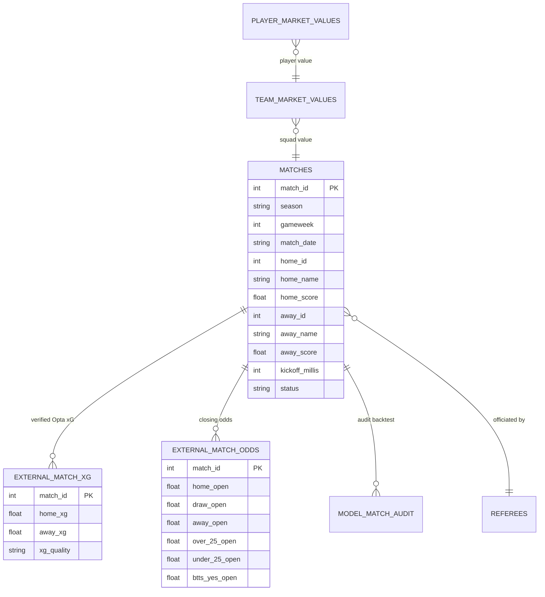

# Premier League Tahmin Motoru & Veri Mimarisi — Kapsamlı Model, Benchmark ve Yönetici Raporu

**Rapor Tarihi:** 17 Ekim 2026  
> 🗂️ **Yapı (17 Ekim 2026'dan itibaren):** Bu belge **ana indekstir**: özet karne, veri/ETL, edge denetimi, metodolojik anayasa, API ve yol haritası. Her modelin ayrıntısı kendi raporundadır: [Gol](models/goals_model.md) · [1X2](models/outcome_1x2_model.md) · [Korner](models/corners_model.md) · [Kart](models/cards_model.md) · [Kurtarış](models/saves_model.md) · [Ofsayt](models/offsides_model.md) · [Taç](models/throws_model.md). Bir model değiştiğinde önce kendi raporu, sonra aşağıdaki özet karne güncellenir.

**Kapsanan Tüm Modeller:**
- ⚽ **Gol Modeli (`v1.4`, 19 Ekim 2026):** 58 Özellikli (`full`, α=3) Poisson skor matrisi + Dixon-Coles düzeltmesi ($w_{dc}=0$), lojistik 1X2'ye hizalı skor matrisi (`models/production/goals_models_v1.joblib`)
- 🎯 **1X2 Maç Sonucu Modeli (`v1.1`):** 77 Özellikli L2 Çok Terimli Lojistik Regresyon & Sıcaklık Kalibrasyonu (`models/production/outcome_models_v1.joblib`)
- 📊 **Sayım & Maç Dinamikleri Modelleri:** Korner (`corner_model_v1`), Kart (`cards_model_v1`), Kurtarış (`saves_model_v1`), Ofsayt (`offside_model_v1`), Taç (`throws_model_v1`)
- 🗄️ **Veritabanı & ETL Altyapısı:** `data/premier_league.db` (SQLite3, 12 tablo, 1.900 fikstür) & Parquet katmanı  
**Değerlendirilen Maç Havuzu:** 1.140 İleri Holdout Maçı (2023/24, 2024/25, 2025/26) + 60 maçlık kilitli canlı test (2026/27, yalnızca raporlama).  
> ⚠️ **17 Ekim 2026 Bağımsız Denetimi:** Önceki sürümdeki "1.200 maç" rakamları kilitli 2026/27 sezonunu da içeriyordu ve bazı metrikler (ECE %2.17, "Bivariate Poisson" adı, `POST /api/predict`) hatalıydı. Düzeltilmiş rakamlar ve tüm bulgular için bkz. **[Gol Model Raporu — Bölüm 11](models/goals_model.md#bölüm-11-bağımsız-denetim-17-ekim-2026--gol-modeli--api-bulguları)**.  
**Dokümantasyon Ağı:** [Ana Sayfa (README)](../../README.md) · [Paper Trading Protokolü](paper_trading_protocol_2026_27.md) · [AI Context & Parametreler](../../AI_CONTEXT.md) · [API Entegrasyonu](../model_api_integration.md) · [Veri Kataloğu](../../VERI_VE_GOSTERIM_KATALOGU.md)

---

## 📌 İçindekiler
1. [BÖLÜM 1: Yönetici Özeti & Genel Sistem Görünümü](#bölüm-1-yönetici-özeti--genel-sistem-görünümü)
2. [BÖLÜM 2: Veritabanı, Veri Kaynakları ve ETL Mimarisi](#bölüm-2-veritabanı-veri-kaynakları-ve-etl-mimarisi)
3. BÖLÜM 3: Gol Modeli → **[Gol Model Raporu](models/goals_model.md)**
4. BÖLÜM 4: 1X2 Maç Sonucu Modeli → **[1X2 Model Raporu](models/outcome_1x2_model.md)**
5. BÖLÜM 5: Sayım Modelleri → [Korner](models/corners_model.md) · [Kart](models/cards_model.md) · [Kurtarış](models/saves_model.md) · [Ofsayt](models/offsides_model.md) · [Taç](models/throws_model.md)
6. [BÖLÜM 6: Piyasa, Bahis ve Edge Gerçeği (Holdout Oran Denetimi)](#bölüm-6-piyasa-bahis-ve-edge-gerçeği-holdout-oran-denetimi)
7. BÖLÜM 7: Reddedilen Deneyler → her modelin kendi raporunda
8. [BÖLÜM 8: Metodolojik Anayasa & Sıfır Sızıntı (Zero-Leakage)](#bölüm-8-metodolojik-anayasa--sıfır-sızıntı-zero-leakage)
9. [BÖLÜM 9: Sistem & API Entegrasyonu (Nerede Kullanılır?)](#bölüm-9-sistem--api-entegrasyonu-nerede-kullanılır)
10. [BÖLÜM 10: Sonuç ve Üretim Yol Haritası](#bölüm-10-sonuç-ve-üretim-yol-haritası)
11. BÖLÜM 11: Gol Modeli Bağımsız Denetimi → **[Gol Model Raporu](models/goals_model.md#bölüm-11-bağımsız-denetim-17-ekim-2026--gol-modeli--api-bulguları)**
    - [11.10 Eksiklerin Giderilmesi Denemeleri](models/goals_model.md#1110-eksiklerin-giderilmesi-denemeleri-17-ekim-2026) · [11.11 Güncel Değerler](models/goals_model.md#1111-gol-modeli--güncel-değerler-v14-19-ekim-2026) · [11.12 İş Akışı](models/goals_model.md#1112-gol-modeli-iş-akışı-workflow)

---

## BÖLÜM 1: Yönetici Özeti & Genel Sistem Görünümü

Premier League Model platformu; İngiltere Premier League maçları için maç öncesi taktiksel veri madenciliğinden Opta olay akışlarına, $13 \times 13$ iki değişkenli skor matrisinden 1X2 maç sonucu olasılıklarına ve sayım hedeflerine kadar tüm tahminleri tek bir tutarlı mimaride birleştiren uçtan uca kantitatif bir analiz sistemidir.

### Tüm Üretim Modellerinin Özet Karnesi:

| Model / Hedef | Üretim Algoritması | Girdi Sayısı | Holdout Havuzu | Temel Başarı Metriği | Temel Çizgi (Baseline) | Karar / Durum |
| :--- | :--- | :---: | :---: | :---: | :---: | :--- |
| **[2.5 Gol Üst / Alt](models/goals_model.md)** | Feature-Poisson ($w_{dc}=0$), iç içe seçim (skor NLL) | 58 Özellik | 1.140 Maç | **Log-Loss `0.6774`** (haftalık yeniden eğitimle `0.6760`), skor NLL `2.9786`, ECE (desil) `%5.1` | Prior: $\Delta=-0.0074$, CI $[-0.0146,-0.0001]$ (sınırda anlamlı); lig ortalaması: $\Delta=-0.0051$, CI $[-0.0119,+0.0019]$ — **anlamlı değil**; Bet365'ten $+0.0086$ kötü | ⚠️ **Üretimde; skor dağılımı iyi, toplam gol pazarında lig ortalamasını/piyasayı geçen beceri yok** ([Gol Model Raporu §11.11](models/goals_model.md)) |
| **[1.5 & 3.5 & BTTS](models/goals_model.md)** | $13 \times 13$ skor matrisi marjinali (bağımsız Poisson × DC $\tau$), lojistik 1X2'ye hizalı | 58 Özellik | 1.140 Maç | O3.5 üç sezonda da prior'dan iyi; O1.5 ve BTTS 2024/25'te prior'dan hafif kötü; BTTS lig ortalamasını geçemedi (kapı ❌, etiket kapalı) | Tüm pazarlar ve 1X2 aynı matristen, tutarlı | 🏆 **Üretimde Aktif** |
| **[1X2 Maç Sonucu](models/outcome_1x2_model.md)** | L2 Çok Terimli Lojistik ($C=0.003, T=0.9591$) | 77 Özellik | 304 Maç | **Log-Loss `1.026`**, Brier `0.617` | Sınıf-Prior: `1.092` ($p=0.9992$) | 🏆 **Üretimde Aktif** |
| **[Korner Sayımı](models/corners_model.md)** | ElasticNet (`elastic_0.05_0.8`) | 10 Özellik | 316 Maç | **RMSE `3.1999`**, MAE `2.6023`; dış sezon 2/3 | Lig Ortalaması: `3.2405` | 🏆 **Üretimde; kazanç küçük (R² 0.004)** |
| **[Taç Atışı Sayımı](models/throws_model.md)** | Poisson Regresyonu (`poisson_10`) | 14 Özellik | 316 Maç | **RMSE `7.0221`**, MAE `5.6042`; dış sezon 3/3 | Lig Ortalaması: `7.3881` | 🏆 **Üretimde Aktif** |
| **[Ofsayt Sayımı](models/offsides_model.md)** | Ridge Regresyonu (`ridge_250`) | 10 Özellik | 316 Maç | **RMSE `1.9102`**, MAE `1.5231`; dış sezon 3/3 | Lig Ortalaması: `2.0238` | 🏆 **Üretimde Aktif** |
| **[Kart Sayımı](models/cards_model.md)** | Sabit Ortalama (`training_mean`) | 11 Aday | 316 Maç | **RMSE `2.0014`**; özellikli aday dış sezon 1/3 | Özellikli `poisson_1` holdout'ta ortalamadan kötüydü (`2.0201`) | 🛡️ **Ortalamaya düştü (17 Ekim 2026)** |
| **[Kurtarış Sayımı](models/saves_model.md)** | Sabit Ortalama (`training_mean`) | 13 Aday | 316 Maç | **RMSE `2.3785`** | CV kapısı geçilemedi (2/4 kat) | 🛡️ **Ortalama Kilitli** |

---

## BÖLÜM 2: Veritabanı, Veri Kaynakları ve ETL Mimarisi

Sistem `data/premier_league.db` SQLite3 veritabanı (12 tablo, 1.900 fikstür) ve yüksek performanslı Parquet katmanı üzerinde çalışır.

### 2.1. Varlık İlişkileri ve Veritabanı Şeması (ERD)



### 2.2. Tablo Envanteri:
1. `matches` (1.900 satır, 39 sütun): Fikstür ana tablosu; 1.580 tamamlanmış, 320 yaklaşan maç.
2. `external_match_xg` (1.564 satır, 8 sütun): TheStatsAPI / Opta doğrulanmış şut koordinatları ve kümülatif takım xG değerleri.
3. `external_match_odds` (1.531 satır, 29 sütun): Açılış ve kapanış bahis oranları (1X2, Over/Under 2.5, BTTS). 2023/24–2025/26: sezon başına 380 maç, yalnızca Bet365 kapanış; 2026/27: 80 maç, 5 büro.
4. `player_market_values` (1.771 satır, 10 sütun): Transfermarkt oyuncu değerleri, yaş, mevki ve uyruk bilgileri.
5. `team_market_values` (102 satır, 9 sütun): Kulüp bazında sezonluk toplam kadro değerleri.
6. `referees` (153 satır, 15 sütun): Hakem maç sayıları, kart ve faul ortalamaları, `strictness_label` (katılık endeksi).
7. `model_match_audit` (440 satır, 39 sütun): Model tahminleri ile gerçekleşen maç sonuçlarının karşılaştırma kaydı.
8. Önbellek tabloları: `tm_clubs_cache` (280), `team_transfers_cache` (27), `team_season_transfers_cache` (6).

### 2.3. Olay Akışından Kurtarma (Event-Stream Recovery) & Sızıntı Yalıtımı
- **Korner Kurtarımı:** Opta özet tablolarında eksik olan 67 maçlık korner verisi, olay akışındaki dakika bazlı korner vuruşları taranarak başarıyla kurtarılmıştır.
- **Sıfır Sızıntı (`shift(1)`):** Tüm hareketli (`roll_10`) ve üssel ortalamalar (`ewma_02`), kesin olarak maç öncesi durumdan (`state_after.shift(1)`) hesaplanır. Eşzamanlı maçlar aynı blokta işlenir.

---

## BÖLÜM 3: Gol Modeli (Bağımsız Poisson + Dixon-Coles)

➡️ Taşındı: **[Gol Model Raporu](models/goals_model.md)** (mimari, ρ doğrulaması, uç risk tablosu).

---

## BÖLÜM 4: 1X2 Maç Sonucu Modeli (Lojistik Regresyon & Kalibrasyon)

➡️ Taşındı: **[1X2 Model Raporu](models/outcome_1x2_model.md)** · ayrıntılı denetim: [1x2_model_audit.md](1x2_model_audit.md).

---

## BÖLÜM 5: Sayım & Maç Dinamikleri Modelleri (Korner, Kart, Kurtarış, Ofsayt, Taç)

➡️ Her sayım modelinin kendi raporu var: [Korner](models/corners_model.md) · [Kart](models/cards_model.md) · [Kurtarış](models/saves_model.md) · [Ofsayt](models/offsides_model.md) · [Taç](models/throws_model.md). Ortak seçim kuralları Bölüm 8 madde 7'dedir.

---

## BÖLÜM 6: Piyasa, Bahis ve Edge Gerçeği (Holdout Oran Denetimi)

218 oran eşleşmeli holdout maçında büro kapanış oranları ile model olasılıkları karşılaştırılmıştır:
- Büro Kapanış ROC-AUC: `0.5962`
- Model ROC-AUC: `0.5843`
- Fark: $\Delta \text{AUC} = +0.0118$ (10k Bootstrap %95 CI: $[-0.0483, +0.0723]$, $p=0.3520$). Fark istatistiksel olarak anlamsızdır.

### Eşik Taraması ve Çoklu Hipotez Düzeltmesi ($k=7$):

| Eşik (Edge) | Maç ($N$) | Kazanma (%) | Simüle ROI | Ham $p$ (Binom) | Bonferroni $p$ | BH FDR $q$ | İstatistiksel Karar |
| :--- | :---: | :---: | :---: | :---: | :---: | :---: | :--- |
| **Edge $> 0\%$** | 118 | %50.0 | -%6.99 | 0.6491 | 1.0000 | 0.8714 | İstatistiki gürültü. |
| **Edge $> 2\%$** | 67 | %55.2 | +%6.25 | 0.2368 | 1.0000 | 0.8289 | İstatistiki gürültü. |
| **Edge $> 3\%$** | 51 | %56.9 | **+%10.02**| 0.1995 | **1.0000** | **0.8289** | Bonferroni ve FDR ile gürültü kanıtlandı. |
| **Edge $> 4\%$** | 32 | %50.0 | -%1.62 | 0.5432 | 1.0000 | 0.8714 | İstatistiki gürültü. |
| **Edge $> 5\%$** | 18 | %50.0 | -%3.42 | 0.5916 | 1.0000 | 0.8714 | İstatistiki gürültü. |

$N=51$ maçta görülen +%10.02 ROI, çoklu hipotez düzeltmesi sonrası ($q = 0.8289$) tamamen rastgele varyans çıkmıştır. Bu nedenle canlı 2026/27 sezonunda $N \ge 200$ maçlık resmi [Paper Trading Protokolü](paper_trading_protocol_2026_27.md) başlatılmıştır.

---

## BÖLÜM 7: Dürüst Zayıflıklar & Tüm Modellerde Reddedilen Deneyler

➡️ Reddedilen deneyler artık her modelin kendi raporundadır: [Gol](models/goals_model.md#reddedilen-deneyler-gol) · [1X2](models/outcome_1x2_model.md#reddedilen-deneyler-1x2) · [Kart](models/cards_model.md#5-reddedilen--uygulanmayan-deneyler) · [Kurtarış](models/saves_model.md#5-reddedilen-deneyler).

---

## BÖLÜM 8: Metodolojik Anayasa & Sıfır Sızıntı (Zero-Leakage)

1. **Zero Data Snooping:** Kalibratörler veya shrinkage katsayıları asla test havuzunda optimize edilemez; sadece train fold'larında öğrenilir.
2. **İstatistiksel Güvence ($N < 500$):** 10.000 Bootstrap CI ve Binom CI zorunludur. $k > 1$ alt segment testinde Bonferroni veya Benjamini-Hochberg FDR düzeltmesi uygulanır.
3. **Çoklu Piyasa Monotonluğu:** Tüm gol pazarları tek bir $13 \times 13$ skor matrisinden türetilir; ayrık alt modeller yasaktır.
4. **Sıfır Hedef Sızıntısı (`shift(1)`):** Tüm hareketli istatistikler maç gününden bir önceki maçtan hesaplanır.
5. **Kilitli Sezonlar:** İçinde bulunulan 2026/27 sezonu model seçiminde kullanılmaz; saf canlı test katmanı olarak tutulur.
6. **Determinizm:** Tüm rassal süreçler sabit tohumludur (`random_state=42`).
7. **Sayım Modeli Kapıları (17 Ekim 2026):** Özellikli bir sayım modeli üretime ancak iki kapıyı da geçerse girer; aksi halde `training_mean` kullanılır ve API `model_skill = "baseline"` döner (`src/models/model_utils.py`):
   - **CV kapısı:** geliştirme döneminin (ilk %80) 4 genişleyen katında ortalamaya karşı ≥%0.5 RMSE kazancı ve ≥3/4 kat galibiyeti.
   - **Dış sezon kapısı:** her tam sezonun yalnızca önceki sezonlarla seçilip eğitildiği iç içe değerlendirmede, tam sezonların **çoğunluğunda** ortalamayı yenmek. Kilitli sezon sayılmaz (madde 5). Son %20 holdout kilitli sezonu içerdiği için bu karar onunla verilmez (madde 1); holdout yalnızca raporlanır.

---

## BÖLÜM 9: Sistem & API Entegrasyonu (Nerede Kullanılır?)

> Düzeltme: uç nokta `GET /api/predict?home_id=&away_id=` şeklindedir (`src/api/server.py`, `predict_match`). 1X2 alanı `outcome` altında döner ve **lojistik 1X2 modelinden** gelir; gol pazarları, bu 1X2'ye hizalanmış skor matrisinden gelir (17 Ekim 2026'dan itibaren tutarlı — bkz. [Gol Model Raporu §11.8](models/goals_model.md)).

```yaml
api_integration_mapping:
  1x2_prediction:
    endpoint: "GET /api/predict -> outcome { home_win_pct, draw_pct, away_win_pct }  # outcome_models_v1 (lojistik)"
    components: ["PredictorTab.jsx", "MatchPredictionTab.jsx", "PredictorMetricCards.jsx"]
  goals_markets:
    endpoint: "GET /api/predict -> goals { over_1.5, over_2.5, over_3.5, btts_pct, btts_prediction, team_totals, expected_*_goals }  # goals_models_v1 (skor matrisi)"
    components: ["MatchPredictionTab.jsx", "PredictorMetricCards.jsx"]
  secondary_metrics:
    endpoint: "GET /api/predict -> corners, cards, saves, offsides, throws"
    components: ["MatchPredictionTab.jsx", "PredictorMetricCards.jsx"]
  backtest_audit:
    endpoint: "GET /api/audit/goals"
    components: ["ModelAuditTab.jsx"]
```

---

## BÖLÜM 10: Sonuç ve Üretim Yol Haritası

1. **Üretim Kararı:** 58 Özellikli Poisson + Dixon-Coles Gol Modeli (`goals_models_v1`, matris lojistik 1X2'ye hizalı), 77 Özellikli Lojistik 1X2 Modeli (`outcome_models_v1`) ve 5 sayım modeli üretimdedir; bunlardan korner, ofsayt ve taç özellikli, kart ve kurtarış sabit ortalamadır (Bölüm 8 madde 7).
2. **Model Sadeleştirme (Occam's Razor):** ✅ Tamamlandı — gol modeli 58 → 11 özelliğe indi (`effective_log_mv_ratio` dahil çıkarıldı), doğruluk kaybı yok ([Gol Model Raporu §11.9](models/goals_model.md)).
3. **Canlı Paper Trading Takibi:** 2026/27 sezonunda Edge $>2\%, >3\%, >5\%$ portföyleri [Paper Trading Protokolü](paper_trading_protocol_2026_27.md) çerçevesinde canlı oranlarla $N \ge 200$ maçlık tescil kararına kadar izlenecektir.
4. **Denetim Sonrası Öncelikler (17 Ekim 2026):** [Gol Model Raporu §11.6](models/goals_model.md)'daki P0 maddeleri (kalibratörün devreye alınması, API'de tek 1X2 kaynağı, BTTS etiketi, iç içe hiperparametre seçimi) `v1.3`'ten önce kapatılmalıdır.

---

## BÖLÜM 11: Bağımsız Denetim (17 Ekim 2026) — Gol Modeli & API Bulguları

➡️ Taşındı: **[Gol Model Raporu — Bölüm 11](models/goals_model.md#bölüm-11-bağımsız-denetim-17-ekim-2026--gol-modeli--api-bulguları)**. Alt bölüm numaraları (11.1–11.12) orada korunmuştur.

---
