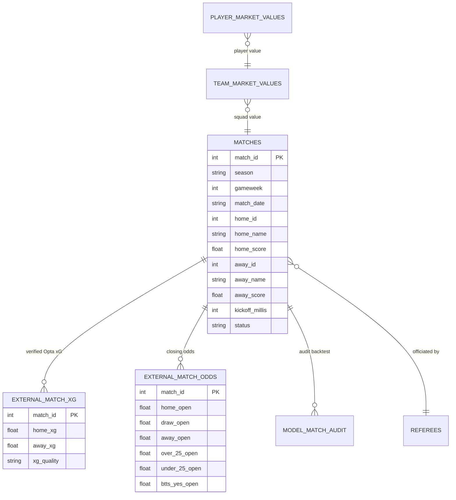

# Premier League Tahmin Motoru & Veri Mimarisi — Kapsamlı Model, Benchmark ve Yönetici Raporu

**Rapor Tarihi:** 17 Kasım 2026
> **Yapı (17 Ekim 2026'dan itibaren):** Bu belge **ana indekstir**: özet karne, veri/ETL, edge denetimi, metodolojik anayasa, API ve yol haritası. Her modelin ayrıntısı kendi raporundadır: [Gol](models/goals_model.md) · [1X2](models/outcome_1x2_model.md) · [Korner](models/corners_model.md) · [Kart](models/cards_model.md) · [Kurtarış](models/saves_model.md) · [Ofsayt](models/offsides_model.md) · [Taç](models/throws_model.md). Bir model değiştiğinde önce kendi raporu, sonra aşağıdaki özet karne güncellenir.

**Kapsanan Tüm Modeller:**
- **Gol Modeli (`v1.6`, 17 Kasım 2026):** 60 Özellikli (`full`, α=3) Poisson skor matrisi + Dixon-Coles düzeltmesi ($w_{dc}=0$), lojistik 1X2'ye (`v1.4`) hizalı skor matrisi (`models/production/premier_league/goals_models_v1.joblib`)
- **1X2 Maç Sonucu Modeli (`v1.4`, 17 Kasım 2026):** 74 Özellikli L2 Çok Terimli Lojistik Regresyon (`C=0.003`) & OOF Sıcaklık/Bias Kalibrasyonu (`models/production/premier_league/outcome_models_v1.joblib`)
- **Sayım & Maç Dinamikleri Modelleri:** Korner (`corner_model_v1`, `training_mean`), Kart (`cards_model_v1`, `training_mean`), Kurtarış (`saves_model_v1`, `training_mean`), Ofsayt (`offside_model_v1`, `ridge_250`), Taç (`throws_model_v1`, `ridge_100`)
- **Veritabanı & ETL Altyapısı:** `data/football.db` (SQLite3, 1.900 PL fikstürü, toplam 3.476 maç satırı) & Parquet katmanı
**Değerlendirilen Maç Havuzu:** 1.140 İleri Dış Sezon Maçı (2023/24, 2024/25, 2025/26) + 304 maçlık 1X2 holdout + 88 maçlık kilitli canlı sezon (2026/27, yalnızca prospektif izleme).
> **17 Ekim 2026 Bağımsız Denetimi:** Önceki sürümdeki "1.200 maç" rakamları kilitli 2026/27 sezonunu da içeriyordu ve bazı metrikler (ECE %2.17, "Bivariate Poisson" adı, `POST /api/predict`) hatalıydı. Düzeltilmiş rakamlar ve tüm bulgular için bkz. **[Gol Model Raporu — Bölüm 11](models/goals_model.md#bölüm-11-bağımsız-denetim-17-ekim-2026--gol-modeli--api-bulguları)**.  
**Dokümantasyon Ağı:** [Ana Sayfa (README)](../../README.md) · [Paper Trading Protokolü](../paper_trading_protocol_2026_27.md) · [Artifact Registry](../artifact_registry.md) · [API Entegrasyonu](../model_api_integration.md) · [Veri Kataloğu](../data_and_ui_catalog.md)

---

## İçindekiler
1. [BÖLÜM 1: Yönetici Özeti & Genel Sistem Görünümü](#bölüm-1-yönetici-özeti--genel-sistem-görünümü)
2. [BÖLÜM 2: Veritabanı, Veri Kaynakları ve ETL Mimarisi](#bölüm-2-veritabanı-veri-kaynakları-ve-etl-mimarisi)
3. BÖLÜM 3: Gol Modeli → **[Gol Model Raporu](models/goals_model.md)**
4. BÖLÜM 4: 1X2 Maç Sonucu Modeli → **[1X2 Model Raporu](models/outcome_1x2_model.md)**
5. BÖLÜM 5: Sayım Modelleri → [Korner](models/corners_model.md) · [Kart](models/cards_model.md) · [Kurtarış](models/saves_model.md) · [Ofsayt](models/offsides_model.md) · [Taç](models/throws_model.md)
6. [BÖLÜM 6: Piyasa, Bahis ve Edge Gerçeği (Holdout Oran Denetimi)](#bölüm-6-piyasa-bahis-ve-edge-gerçeği-holdout-oran-denetimi)
7. BÖLÜM 7: Reddedilen Deneyler → her modelin kendi raporunda
8. [BÖLÜM 8: Metodolojik Anayasa & Sıfır Sızıntı (Zero-Leakage)](#bölüm-8-metodolojik-anayasa--sıfır-sızıntı-zero-leakage)
9. [BÖLÜM 9: Sistem & API Entegrasyonu (Nerede Kullanılır?)](#bölüm-9-sistem--api-entegrasyonu-nerede-kullanılır)
10. [BÖLÜM 10: Sonuç ve Üretim Yol Haritası](#bölüm-10-sonuç-ve-üretim-yol-haritası)
11. BÖLÜM 11: Gol Modeli Bağımsız Denetimi → **[Gol Model Raporu](models/goals_model.md#bölüm-11-bağımsız-denetim-17-ekim-2026--gol-modeli--api-bulguları)**
    - [11.10 Eksiklerin Giderilmesi Denemeleri](models/goals_model.md#1110-eksiklerin-giderilmesi-denemeleri-17-ekim-2026) · [11.11 Güncel Değerler](models/goals_model.md#1111-gol-modeli--güncel-değerler-v16-17-kasım-2026) · [11.12 İş Akışı](models/goals_model.md#1112-gol-modeli-iş-akışı-workflow)

---

## BÖLÜM 1: Yönetici Özeti & Genel Sistem Görünümü

Premier League Model platformu; İngiltere Premier League maçları için maç öncesi taktiksel veri madenciliğinden Opta olay akışlarına, $13 \times 13$ iki değişkenli skor matrisinden 1X2 maç sonucu olasılıklarına ve sayım hedeflerine kadar tüm tahminleri tek bir tutarlı mimaride birleştiren uçtan uca kantitatif bir analiz sistemidir.

### Tüm Üretim Modellerinin Özet Karnesi:

| Model / Hedef | Üretim Algoritması | Girdi Sayısı | Holdout Havuzu | Temel Başarı Metriği | Temel Çizgi (Baseline) | Karar / Durum |
| :--- | :--- | :---: | :---: | :---: | :---: | :--- |
| **[2.5 Gol Üst / Alt](models/goals_model.md)** | Feature-Poisson (`v1.6`, $w_{dc}=0$), iç içe seçim (skor NLL) | 60 Özellik | 1.140 Maç | **Log-Loss `0.6763`** (haftalık refit `0.6752`), skor NLL `2.9673`, ECE `%4.51` | Prior: $\Delta=-0.0085$, CI $[-0.0163,-0.0005]$ (anlamlı); sabit Poisson: $\Delta=-0.0062$, CI $[-0.0136,+0.0014]$; Bet365'ten $+0.0074$ | **Üretimde Aktif** ([Gol Model Raporu §11.11](models/goals_model.md)) |
| **[1.5 & 3.5 & BTTS](models/goals_model.md)** | $13 \times 13$ skor matrisi marjinali (bağımsız Poisson × DC $\tau$), lojistik 1X2'ye (`v1.4`) hizalı | 60 Özellik | 1.140 Maç | O1.5/O2.5/O3.5/KG kalibratörleri aktif; KG LL `0.6805` (pazar kapısı geçemedi, etiket kapalı) | Tüm pazarlar ve 1X2 aynı matristen, tutarlı | **Üretimde Aktif (KG etiketi kapalı)** |
| **[1X2 Maç Sonucu](models/outcome_1x2_model.md)** | L2 Çok Terimli Lojistik (`v1.4`, $C=0.003$) + OOF sıcaklık/bias | 74 Özellik | 304 Maç (+ 1.140 3S) | **Holdout LL `1.024`**, Brier `0.616`, RPS `0.2073`, İsabet `%50.33`; 3S Pooled LL `0.9732` | Sınıf-Prior: `1.092` ($P=\%99.98$) | **Üretimde Aktif (`v1.4`)** |
| **[Korner Sayımı](models/corners_model.md)** | Sabit Ortalama (`training_mean`) | 10 Aday | 322 Maç | **RMSE `3.2276`**, MAE `2.6601`; geliştirme dış sezon 1/2 | Ortalama ile aynı | **[Baseline] Ortalamada** |
| **[Taç Atışı Sayımı](models/throws_model.md)** | Ridge Regresyonu (`ridge_100`) | 14 Özellik | 322 Maç | **RMSE `6.9994`**, MAE `5.5780`, $R^2$ `0.0932`; dış sezon 2/2 | Lig Ortalaması: `7.3884` | **Üretimde Aktif** |
| **[Ofsayt Sayımı](models/offsides_model.md)** | Ridge Regresyonu (`ridge_250`) | 10 Özellik | 322 Maç | **RMSE `1.9263`**, MAE `1.5386`, $R^2$ `0.0931`; dış sezon 2/2 | Lig Ortalaması: `2.0356` | **Üretimde Aktif** |
| **[Kart Sayımı](models/cards_model.md)** | Sabit Ortalama (`training_mean`) | 11 Aday | 322 Maç | **RMSE `1.9744`**, MAE `1.5783`; geliştirme dış sezon 1/2 | Ortalama ile aynı | **[Baseline] Ortalamada** |
| **[Kurtarış Sayımı](models/saves_model.md)** | Sabit Ortalama (`training_mean`) | 13 Aday | 322 Maç | **RMSE `2.3633`**, MAE `1.9085`; geliştirme dış sezon 0/2 | Ortalama ile aynı | **[Baseline] Ortalamada** |

---

## BÖLÜM 2: Veritabanı, Veri Kaynakları ve ETL Mimarisi

Sistem `data/football.db` SQLite3 veritabanı (`matches`: 1.900 PL fikstürü; 772 UCL ve 804 UEL maçı dahil toplam 3.476 satır) ve yüksek performanslı Parquet katmanı üzerinde çalışır.

### 2.1. Varlık İlişkileri ve Veritabanı Şeması (ERD)



### 2.2. Tablo Envanteri:
1. `matches` (`3.476` satır: PL `1.900` — `1.608` tamamlanmış, `292` yaklaşan; UCL `772`, UEL `804`): Fikstür ana tablosu.
2. `external_match_xg` (`2.966` satır): TheStatsAPI / Opta doğrulanmış kümülatif takım xG değerleri.
3. `external_match_odds` (`2.823` satır): Açılış ve kapanış bahis oranları (1X2, Over/Under 2.5, BTTS).
4. `player_market_values` (`1.771` satır): Transfermarkt oyuncu değerleri, yaş, mevki ve uyruk bilgileri.
5. `team_market_values` (`102` satır): Kulüp bazında sezonluk toplam kadro değerleri.
6. `referees` (`155` satır): Hakem maç sayıları, kart ve faul ortalamaları, `strictness_label` (katılık endeksi).
7. `model_match_audit` (`468` satır): Model tahminleri ile gerçekleşen maç sonuçlarının karşılaştırma kaydı.
8. Ham yanıt ve önbellek tabloları: `external_match_payloads` (`7.841`), `external_competition_payloads` (`815`), `team_transfers_cache`, `team_season_transfers_cache`.

### 2.3. Olay Akışından Kurtarma (Event-Stream Recovery) & Sızıntı Yalıtımı
- **Korner Kurtarımı:** Opta özet tablolarında eksik olan 67 maçlık korner verisi, olay akışındaki dakika bazlı korner vuruşları taranarak başarıyla kurtarılmıştır.
- **Sıfır Sızıntı (`shift(1)`):** Tüm hareketli (`roll_10`) ve üssel ortalamalar (`ewma_02`), kesin olarak maç öncesi durumdan (`state_after.shift(1)`) hesaplanır. Eşzamanlı maçlar aynı blokta işlenir.

---

## BÖLÜM 3: Gol Modeli (Bağımsız Poisson + Dixon-Coles)

Taşındı: **[Gol Model Raporu](models/goals_model.md)** (mimari, ρ doğrulaması, uç risk tablosu).

---

## BÖLÜM 4: 1X2 Maç Sonucu Modeli (Lojistik Regresyon & Kalibrasyon)

Taşındı: **[1X2 Model Raporu](models/outcome_1x2_model.md)** · ayrıntılı denetim: [1x2_model_audit.md](../../reports/audits/1x2_model_audit.md).

---

## BÖLÜM 5: Sayım & Maç Dinamikleri Modelleri (Korner, Kart, Kurtarış, Ofsayt, Taç)

Her sayım modelinin kendi raporu var: [Korner](models/corners_model.md) · [Kart](models/cards_model.md) · [Kurtarış](models/saves_model.md) · [Ofsayt](models/offsides_model.md) · [Taç](models/throws_model.md). Ortak seçim kuralları Bölüm 8 madde 7'dedir.

---

## BÖLÜM 6: Piyasa, Bahis ve Edge Gerçeği (Holdout Oran Denetimi)

218 oran eşleşmeli holdout maçında büro kapanış oranları ile model olasılıkları karşılaştırılmıştır:
- Büro Kapanış ROC-AUC: `0.5962`
- Model ROC-AUC: `0.5843`
- Fark: $\Delta \text{AUC} = +0.0118$ (10k Bootstrap %95 CI: $[-0.0483, +0.0723]$, $p=0.3520$). Fark istatistiksel olarak anlamsızdır.

### Eşik Taraması ve Çoklu Hipotez Düzeltmesi ($k=7$):

| Eşik (Edge) | Maç ($N$) | Kazanma (%) | Simüle ROI | Ham $p$ (Binom) | Bonferroni $p$ | BH FDR $q$ | İstatistiksel Karar |
| :--- | :---: | :---: | :---: | :---: | :---: | :---: | :--- |
| **Edge $> 0\%$** | 118 | %50.0 | -%6.99 | 0.6491 | 1.0000 | 0.8714 | İstatistiki gürültü. |
| **Edge $> 2\%$** | 67 | %55.2 | +%6.25 | 0.2368 | 1.0000 | 0.8289 | İstatistiki gürültü. |
| **Edge $> 3\%$** | 51 | %56.9 | **+%10.02**| 0.1995 | **1.0000** | **0.8289** | Bonferroni ve FDR ile gürültü kanıtlandı. |
| **Edge $> 4\%$** | 32 | %50.0 | -%1.62 | 0.5432 | 1.0000 | 0.8714 | İstatistiki gürültü. |
| **Edge $> 5\%$** | 18 | %50.0 | -%3.42 | 0.5916 | 1.0000 | 0.8714 | İstatistiki gürültü. |

$N=51$ maçta görülen +%10.02 ROI, çoklu hipotez düzeltmesi sonrası ($q = 0.8289$) tamamen rastgele varyans çıkmıştır. Bu nedenle canlı 2026/27 sezonunda $N \ge 200$ maçlık resmi [Paper Trading Protokolü](../paper_trading_protocol_2026_27.md) başlatılmıştır.

---

## BÖLÜM 7: Dürüst Zayıflıklar & Tüm Modellerde Reddedilen Deneyler

Reddedilen deneyler artık her modelin kendi raporundadır: [Gol](models/goals_model.md#reddedilen-deneyler-gol) · [1X2](models/outcome_1x2_model.md#reddedilen-deneyler-1x2) · [Kart](models/cards_model.md#5-reddedilen--uygulanmayan-deneyler) · [Kurtarış](models/saves_model.md#5-reddedilen-deneyler).

---

## BÖLÜM 8: Metodolojik Anayasa & Sıfır Sızıntı (Zero-Leakage)

1. **Zero Data Snooping:** Kalibratörler veya shrinkage katsayıları asla test havuzunda optimize edilemez; sadece train fold'larında öğrenilir.
2. **İstatistiksel Güvence ($N < 500$):** 10.000 Bootstrap CI ve Binom CI zorunludur. $k > 1$ alt segment testinde Bonferroni veya Benjamini-Hochberg FDR düzeltmesi uygulanır.
3. **Çoklu Piyasa Monotonluğu:** Tüm gol pazarları tek bir $13 \times 13$ skor matrisinden türetilir; ayrık alt modeller yasaktır.
4. **Sıfır Hedef Sızıntısı (`shift(1)`):** Tüm hareketli istatistikler maç gününden bir önceki maçtan hesaplanır.
5. **Kilitli Sezonlar:** İçinde bulunulan 2026/27 sezonu model seçiminde kullanılmaz; saf canlı test katmanı olarak tutulur.
6. **Determinizm:** Tüm rassal süreçler sabit tohumludur (`random_state=42`).
7. **Sayım Modeli Kapıları (17 Ekim 2026):** Özellikli bir sayım modeli üretime ancak iki kapıyı da geçerse girer; aksi halde `training_mean` kullanılır ve API `model_skill = "baseline"` döner (`src/models/model_utils.py`):
   - **CV kapısı:** geliştirme döneminin (ilk %80) 4 genişleyen katında ortalamaya karşı ≥%0.5 RMSE kazancı ve ≥3/4 kat galibiyeti.
   - **Dış sezon kapısı:** her tam sezonun yalnızca önceki sezonlarla seçilip eğitildiği iç içe değerlendirmede, tam sezonların **çoğunluğunda** ortalamayı yenmek. Kilitli sezon sayılmaz (madde 5). Son %20 holdout kilitli sezonu içerdiği için bu karar onunla verilmez (madde 1); holdout yalnızca raporlanır.

---

## BÖLÜM 9: Sistem & API Entegrasyonu (Nerede Kullanılır?)

> Düzeltme: uç nokta `GET /api/predict?home_id=&away_id=` şeklindedir (`src/api/server.py`, `predict_match`). 1X2 alanı `outcome` altında döner ve **lojistik 1X2 modelinden** gelir; gol pazarları, bu 1X2'ye hizalanmış skor matrisinden gelir (17 Ekim 2026'dan itibaren tutarlı — bkz. [Gol Model Raporu §11.8](models/goals_model.md)).

```yaml
api_integration_mapping:
  1x2_prediction:
    endpoint: "GET /api/predict -> outcome { home_win_pct, draw_pct, away_win_pct }  # outcome_models_v1 (lojistik)"
    components: ["PredictorTab.jsx", "MatchPredictionTab.jsx", "PredictorMetricCards.jsx"]
  goals_markets:
    endpoint: "GET /api/predict -> goals { over_1.5, over_2.5, over_3.5, btts_pct, btts_prediction, team_totals, expected_*_goals }  # goals_models_v1 (skor matrisi)"
    components: ["MatchPredictionTab.jsx", "PredictorMetricCards.jsx"]
  secondary_metrics:
    endpoint: "GET /api/predict -> corners, cards, saves, offsides, throws"
    components: ["MatchPredictionTab.jsx", "PredictorMetricCards.jsx"]
  backtest_audit:
    endpoint: "GET /api/audit/goals"
    components: ["ModelAuditTab.jsx"]
```

---

## BÖLÜM 10: Sonuç ve Üretim Yol Haritası

1. **Üretim Kararı (17 Kasım 2026):** 60 Özellikli Poisson + Dixon-Coles Gol Modeli (`goals_models_v1`, `v1.6`, matris lojistik 1X2'ye hizalı), 74 Özellikli Lojistik 1X2 Modeli (`outcome_models_v1`, `v1.4`) ve 5 sayım modeli üretimdedir; bunlardan taç (`ridge_100`) ve ofsayt (`ridge_250`) özellikli, korner, kart ve kurtarış geliştirme dış sezon kapısı gereği sabit ortalamadır (`training_mean`, Bölüm 8 madde 7).
2. **Model Sadeleştirme & Güncel Mimari:** Gol modelinde `v1.6` (`full` 60 özellik, `α=3.0`, `w_dc=0.0`) iç içe ileri katlarda en düşük skor NLL'yi seçerek üretimde yerini korumaktadır ([Gol Model Raporu §11.11](models/goals_model.md)).
3. **Canlı Paper Trading Takibi:** 2026/27 sezonunda Edge $>2\%, >3\%, >5\%$ portföyleri [Paper Trading Protokolü](../paper_trading_protocol_2026_27.md) çerçevesinde canlı oranlarla $N \ge 200$ maçlık tescil kararına kadar izlenecektir.
4. **Denetim Sonrası Öncelikler:** P0 kalibratör ve tek kaynak hizalama maddeleri `v1.4` / `v1.6` ile kapatılmıştır; piyasa değeri sızıntı kontrolü düşük öncelikli olarak takip edilmektedir ([1X2 Model Raporu §4](models/outcome_1x2_model.md)).

---

## BÖLÜM 11: Bağımsız Denetim (17 Ekim 2026) — Gol Modeli & API Bulguları

Taşındı: **[Gol Model Raporu — Bölüm 11](models/goals_model.md#bölüm-11-bağımsız-denetim-17-ekim-2026--gol-modeli--api-bulguları)**. Alt bölüm numaraları (11.1–11.12) orada korunmuştur.

---
