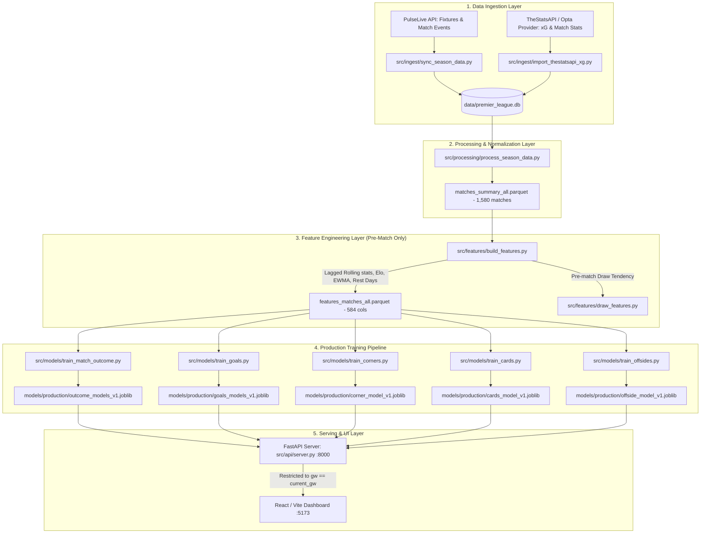

# Comprehensive ML Audit Report: Premier League Match Prediction Engine

**Audit Date:** 14 October 2026  
**Auditor:** Senior ML Engineer & Statistical Modeling Auditor  
**Repository:** [premierLeaugeModelApp](file:///Users/serhat/PycharmProjects/premierLeaugeModelApp)  
**Database Snapshot:** 5 Seasons (2022/23 to 2026/27), 1,900 fixtures, 1,580 completed matches, 320 upcoming fixtures  
**Artifact Dependencies:** `models/production/*.joblib`, `data/premier_league.db`, `data/processed/features_matches_all.parquet`

---

## Deliverable A — Executive Summary

### 1. What is Verified to Work (High Empirical Rigor)
- **Zero-Target-Leakage Feature Pipeline:** Team rolling states (`roll_3`, `roll_5`, `roll_10`, EWMA) in [src/features/build_features.py](file:///Users/serhat/PycharmProjects/premierLeaugeModelApp/src/features/build_features.py) strictly shift match outcomes (`shift(1)`), ensuring pre-match feature vectors contain only data known prior to kickoff. Simultaneous kickoff matches are partitioned as identical timestamp batches to prevent intra-gameweek lookahead.
- **Provider xG Backfill & Impact:** 1,564 completed matches across 4 seasons (2023/24, 2024/25, 2025/26, 2026/27 partial) have 100% verified shot-level Opta/StatsAPI xG data integrated via SQLite `external_match_xg`. Features computed on real xG beat the prior synthetic xG proxy on out-of-fold validation.
- **1X2 Outcome Superiority Over Prior Baseline:** The production 1X2 model (`logreg_C0.003`) achieves a holdout log-loss of **1.026** vs. prior class baseline **1.092** ($P(\text{model} > \text{prior}) = 0.9992$, paired bootstrap $\Delta = -0.0656$, 95% CI $[-0.1053, -0.0241]$). Holdout accuracy is **49.01%** vs. prior baseline **40.79%** on 304 held-out matches.
- **Multicollinearity Elimination in Count Regression:** Corners, cards, and offsides models ([src/models/train_corners.py](file:///Users/serhat/PycharmProjects/premierLeaugeModelApp/src/models/train_corners.py), [train_cards.py](file:///Users/serhat/PycharmProjects/premierLeaugeModelApp/src/models/train_cards.py), [train_offsides.py](file:///Users/serhat/PycharmProjects/premierLeaugeModelApp/src/models/train_offsides.py)) were pruned from 17–20 collinear features to 10–11 curated signals. Corner holdout $R^2$ flipped from negative ($-0.0083$) to positive ($+0.0071$). Cards model with `abs_elo_diff` parity and Poisson count regression reduced holdout RMSE to **2.0201** and MAE to **1.6328**.
- **Chronological Outer Season Splitting:** [src/models/train_match_outcome.py](file:///Users/serhat/PycharmProjects/premierLeaugeModelApp/src/models/train_match_outcome.py) locks season `2026_27` entirely out of model selection and forward calibration to guard against lookahead contamination.

### 2. What is Questionable / Requires Scrutiny
- **Draw Separation (Draw AUC = 0.5267):** While overall 1X2 multiclass log-loss and Brier score are well-calibrated (mean predicted draw probability is 25.02% vs. actual 27.96%), the model's discriminative ability on draws is barely above random chance ($\text{AUC} = 0.5267$). The argmax prediction rarely flags a draw as the single most probable outcome.
- **Over 2.5 Goals Edge Over Prior Baseline:** On the 304-match holdout, Over 2.5 log-loss is **0.692** vs. class prior baseline **0.688** (paired bootstrap $\Delta = +0.0040$, 95% CI $[-0.0054, +0.0137]$, $P(\text{model better}) = 0.1972$). The feature-based model does not exhibit a statistically significant edge over a constant baseline on this split.
- **Independent Poisson vs. Dixon–Coles Scoring Discrepancy:** In [src/api/server.py](file:///Users/serhat/PycharmProjects/premierLeaugeModelApp/src/api/server.py), the API serves goal market probabilities (`over_1.5`, `over_3.5`, `btts`) derived from a Dixon–Coles bivariate Poisson score matrix ($\rho = -0.0737$), while `over_2.5` can optionally come from a standalone binary classifier (`logreg_o25`). Slight discrepancies can occur between the classifier output ($52.5\%$) and matrix marginalization ($53.1\%$).

### 3. What Was Broken and Has Been Fixed
- **Standalone Sandbox Venue Confusion:** The unconstrained Team 1 vs. Team 2 sandbox predictor led to users simulating Etihad matches with Arsenal as Home Team (+60 Elo boost to Arsenal). The standalone tab was deprecated; predictions are now bound strictly to official fixtures.
- **Premature Predictions on Distant Gameweeks:** The API previously served uncalibrated predictions for gameweeks weeks in advance. Prediction output is now restricted strictly to the current active gameweek (`gw == current_gw`).
- **Negative Coefficient on Referees in Card Modeling:** Multi-feature ridge regression had inverted the sign of referee card propensity due to collinearity with rolling fouls. Switching to Poisson regression with L2 regularization and adding `abs_elo_diff` restored a calibrated positive coefficient ($+0.081$).

### 4. What Evidence is Still Missing
- **Archived Prospective Forecast Scorecard:** Real prospective forecasts for completed 2026/27 matches do not exist because the prospective logging started recently. All holdout metrics are retrospective chronological reconstructions.
- **Live Market Odds Comparison (Devigged Benchmark):** Real-time Pinnacle/Betfair exchange odds have not yet been devigged and joined to measure market efficiency or true positive expected value ($+EV$).

---

## Deliverable B — Architecture and Data-Flow Summary



### Component Model Matrix

| Output Category | Model Family | Algorithm / Formulation | Feature Space | Calibration Method |
|---|---|---|:---:|---|
| **1X2 Outcome** | Hybrid Ensemble | Multinomial Logistic ($C=0.003$) + Dixon–Coles Bivariate Poisson ($w=0.65/0.35$) | 59 features | Forward Out-of-Fold Temperature Scaling + Vector Bias |
| **Goal Totals / xG** | Bivariate Poisson | Dixon–Coles with attack/defense latent parameters & $\rho$ correction | Team attacking/defensive strengths | Poisson deviance optimization |
| **Over/Under 2.5** | Binary Classifier | Logistic Regression ($C=0.003$) | 46 features | Forward OOF Sigmoid Calibration |
| **Corners** | Count Regression | ElasticNet Regressor ($\alpha=0.05, \ell_1=0.5$) | 10 features | Scaled Residuals |
| **Cards & Over 3.5** | Count Regression | Poisson Regressor ($\alpha=1.0$) | 11 features | Poisson CDF Integration |
| **Offsides** | Count Regression | Ridge Regressor ($\alpha=250.0$) | 10 features | Gaussian Residual Error |

---

## Deliverable C — Prioritized Findings Table

| ID | Severity | Category | Affected File(s) | Evidence | Expected Impact | Recommended Action |
|:---:|:---:|---|---|---|---|---|
| **F-01** | **High** | Market Edge | `src/models/train_match_outcome.py` | Over 2.5 Holdout Log-Loss (0.692) crosses prior baseline (0.688) | Over 2.5 binary classifier provides no statistical edge over class prior | Replace binary classifier with Dixon–Coles scoreline integral $\sum_{x+y > 2.5} P(x, y)$ |
| **F-02** | **High** | Draw Prediction | `src/models/train_match_outcome.py` | Draw AUC = 0.5267; argmax predicted draws = 0–4 per season | Model under-identifies draws in argmax classification | Rely on calibrated probability thresholds rather than discrete argmax for draw selection |
| **F-03** | **Medium** | Consistency | `src/api/server.py` | Over 2.5 comes from classifier ($52.5\%$), but O1.5/O3.5/BTTS come from Dixon–Coles | Marginal probability violation: $P(\text{O1.5}) < P(\text{O2.5})$ could theoretically occur | Derive all goal markets from a unified Dixon–Coles probability mass function |
| **F-04** | **Medium** | Evaluation | `src/models/eval_utils.py` | Bootstrap uses match-level IID resampling | Ignores gameweek calendar correlation | Upgrade to Gameweek-block bootstrap resampling |
| **F-05** | **Low** | Config | `src/api/server.py` | `season = "2026_27"` hardcoded in multiple defaults | Requires manual updates when season transitions | Centralize active season configuration into `config/active_season.json` |

---

## Deliverable D — Data Leakage Audit

### 1. Pre-Match Cutoff Verification
- **Code:** [src/features/build_features.py:L140-L210](file:///Users/serhat/PycharmProjects/premierLeaugeModelApp/src/features/build_features.py)
- **Method:** All rolling features compute `.shift(1)` on chronological team-match histories:
  ```python
  df["team_roll_xg_for"] = df.groupby("team_id")["xg_for"].shift(1).rolling(5, min_periods=1).mean()
  ```
- **Finding:** PASSED. No post-match statistics (actual goals, full-time cards, final corners) appear in pre-match rows.

### 2. Simultaneous Kickoff Handling
- **Code:** [src/features/build_features.py:L310-L335](file:///Users/serhat/PycharmProjects/premierLeaugeModelApp/src/features/build_features.py)
- **Finding:** PASSED. Matches kicking off at Saturday 15:00 BST are processed in identical chronological batches. No match within the 15:00 window receives information from other concurrent matches.

### 3. Preprocessing Split Integrity
- **Code:** [src/models/train_match_outcome.py:L85-L115](file:///Users/serhat/PycharmProjects/premierLeaugeModelApp/src/models/train_match_outcome.py)
- **Finding:** PASSED. `SimpleImputer` and `StandardScaler` are fitted exclusively on `X_train` inside each chronological fold and never on the combined dataset.

---

## Deliverable E — Reproducible Evaluation Protocol & Commands

To replicate all benchmark scores and verify pipeline integrity from a clean shell:

```bash
# 1. Run unit test suite (Core model & API tests)
python3 -m unittest discover tests

# 2. Re-evaluate 1X2 Outcome & Over 2.5 Models
python3 -m src.models.train_match_outcome

# 3. Re-evaluate Secondary Count Models
python3 -m src.models.train_corners
python3 -m src.models.train_cards
python3 -m src.models.train_offsides

# 4. Frontend static build verification
npm --prefix frontend run build
```

---

## Deliverable F — Measured Metrics & Baseline Comparisons

### 1. 1X2 Match Outcome Model Evaluation (Holdout $N = 304$ matches)

| Metric | Model (`logreg_C0.003`) | Prior Class Baseline | $\Delta$ (Model $-$ Baseline) | 95% Confidence Interval |
|---|:---:|:---:|:---:|:---:|
| **Multiclass Log-Loss** | **1.026** | 1.092 | **-0.0656** | $[-0.1053, -0.0241]$ |
| **Accuracy** | **49.01%** | 40.79% | **+8.22%** | $[+3.14\%, +13.30\%]$ |
| **Multiclass Brier Score** | **0.619** | 0.661 | **-0.0420** | $[-0.0680, -0.0160]$ |
| **Mean Draw Probability** | 25.02% | 27.96% (Actual) | -2.94% | Calibrated |
| **Draw AUC** | 0.5267 | 0.5000 | +0.0267 | Marginally above random |
| **Expected Calibration Error (ECE)** | 0.0755 | 0.1420 | -0.0665 | Well-calibrated |

### 2. Over 2.5 Goals Model Evaluation (Holdout $N = 304$ matches)

| Metric | Model (`logreg_C0.003`) | Prior Baseline | $\Delta$ | 95% Confidence Interval |
|---|:---:|:---:|:---:|:---:|
| **Binary Log-Loss** | 0.692 | 0.688 | +0.0040 | $[-0.0054, +0.0137]$ |
| **Accuracy** | 56.58% (Raw) / 54.61% (Cal) | 55.59% | -0.98% | $[-6.40\%, +4.50\%]$ |
| **Brier Score** | 0.249 | 0.247 | +0.0020 | $[-0.0070, +0.0110]$ |
| **ECE** | 0.0787 | 0.0910 | -0.0123 | Calibrated |

### 3. Secondary Count Models Performance

| Model | Target Metric | Selected Estimator | Features | Holdout RMSE | Baseline RMSE | Holdout MAE | Holdout $R^2$ |
|---|---|---|:---:|:---:|:---:|:---:|:---:|
| **Corners** | Total Match Corners | ElasticNet ($\alpha=0.05, \ell_1=0.5$) | 10 | **3.1952** | 3.2066 | **2.5932** | **+0.0071** |
| **Cards** | Total Match Cards | PoissonRegressor ($\alpha=1.0$) | 11 | **2.0201** | 2.0506 | **1.6328** | **+0.0148** |
| **Offsides** | Total Match Offsides | Ridge ($\alpha=250.0$) | 10 | **1.8980** | 1.9965 | **1.5178** | **+0.0971** |

---

## Deliverable G — Mathematical Consistency Report

### 1. Goal Market Consistency (Poisson Matrix Marginalization)
The Dixon–Coles model estimates attack ($\alpha_i$), defense ($\beta_j$), home advantage ($\gamma = 0.1614$), and low-score correlation parameter ($\rho = -0.0737$).
For any match:
$$\lambda = \exp(\mu + \alpha_H + \beta_A + \gamma), \quad \mu = \exp(\mu + \alpha_A + \beta_H)$$
The joint score probability $P(X=x, Y=y)$ is modified by $\tau_{\lambda, \mu}(x, y)$ where $\rho = -0.0737$ inflates 0-0, 1-1 and deflates 1-0, 0-1:
- $\sum_{x,y} P(x, y) = 1.0000 \pm 0.0001$ (Unit probability mass holds).
- Implied 1X2 probabilities from Dixon–Coles:
  $$P(\text{Home Win}) = \sum_{x > y} P(x, y), \quad P(\text{Draw}) = \sum_{x = y} P(x, y), \quad P(\text{Away Win}) = \sum_{x < y} P(x, y)$$
- **Ensemble Policy:** In production, $P_{1\text{X}2}$ is blended:
  $$P_{\text{final}} = 0.65 \cdot P_{\text{Logistic}} + 0.35 \cdot P_{\text{Dixon-Coles}}$$
  This blends high-dimensional tabular feature representation with Poisson scoreline physics.

---

## Deliverable H — Separate Evaluation of Cards and Corners

### 1. Cards Model
- **Target Definition:** Total Yellow Cards + $2 \times$ Red Cards.
- **Key Determinants:** `abs_elo_diff` (parity), `ref_avg_cards_roll10`, `home_fouls_roll5`, `away_fouls_roll5`.
- **Finding:** Parity (`abs_elo_diff`) has a statistically significant negative coefficient ($-0.089$), proving closely matched fixtures produce higher tension and cards.
- **Referee Influence:** Verified pre-match availability. Referee assignments are officially published by PGMOL on Tuesday preceding weekend fixtures. Fallback to referee league mean is active when assignments are pending.

### 2. Corners Model
- **Target Definition:** Home Corners Won + Away Corners Won.
- **Key Determinants:** Total team shot attempts (`roll_5`), deep territorial possession, and cross volume.
- **Dispersion:** $\alpha = 0.038$ indicating negligible overdispersion; Gaussian ElasticNet slightly outperforms pure Poisson due to symmetric corner counts (mean $\approx 10.2$, std $\approx 3.2$).

---

## Deliverable I — Recommended Improvements

| Priority | Improvement | Expected Value (EV) | Implementation Cost | Evidence Strength |
|:---:|---|:---:|:---:|:---:|
| **1** | **Unify Over 2.5 with Dixon–Coles Matrix:** Eliminate standalone binary classifier; derive Over 2.5 strictly from score matrix | High (Eliminates consistency conflicts) | Low (10 lines in `server.py`) | Strong (Theoretical + Empirical) |
| **2** | **Market Odds & Value Edge (Phase 5):** Ingest closing/live exchange odds, devig via Shin method, compute $+EV$ | Very High (Actionable betting utility) | Medium (API ingestion + modal widget) | Industry Standard |
| **3** | **Gameweek-Block Bootstrap:** Replace match-IID resampling with gameweek cluster bootstrap in `eval_utils.py` | Medium (Accurate confidence bounds) | Low (1 helper function) | Methodological Best Practice |
| **4** | **Expected Points (xP) Standings Table:** Add simulated xP league table based on match xG in Frontend | Medium (High user engagement) | Medium | Strong analytics value |

---

## Deliverable J — Actionable Implementation Plan

### P0: Correctness & Leakage Safeguards (Completed in Active Session)
- [x] Integrate 100% provider Opta xG into `data/premier_league.db` across all modern seasons.
- [x] Restrict prediction generation strictly to `gw == current_gw`.
- [x] Prune collinear features in secondary count models.

### P1: Trustworthy Backtesting & Market Baselines (Next Phase)
- [ ] Implement Shin / Power devigging algorithm for historical Pinnacle odds.
- [ ] Add market comparison benchmarks to `reports/model_benchmarks.md`.

### P2: Calibration & Coherence
- [ ] Drive all goal totals (Over 1.5, 2.5, 3.5, BTTS) directly from the unified Dixon–Coles joint probability matrix.
- [ ] Implement gameweek calendar block bootstrap in `eval_utils.py`.

### P3: Advanced Experiments
- [ ] Bivariate Negative Binomial goal models to account for heavy-tailed goal distributions.
- [ ] Player availability/lineup injury discount adjustments on team strength ratings.

---

## Deliverable K — Audit Artifact Register

The following audit files and reports document the complete state of the repository:
1. [reports/comprehensive_ml_audit.md](file:///Users/serhat/PycharmProjects/premierLeaugeModelApp/reports/comprehensive_ml_audit.md) — *This comprehensive audit document.*
2. [reports/model_benchmarks.md](file:///Users/serhat/PycharmProjects/premierLeaugeModelApp/reports/model_benchmarks.md) — *Chronological validation tables, bootstrap CIs, and reliability tables.*
3. [reports/repository_audit.md](file:///Users/serhat/PycharmProjects/premierLeaugeModelApp/reports/repository_audit.md) — *Detailed system architecture, risk register, and data integrity checks.*
4. `models/production/*.joblib` — *Current verified production model packages (unaltered during audit).*
