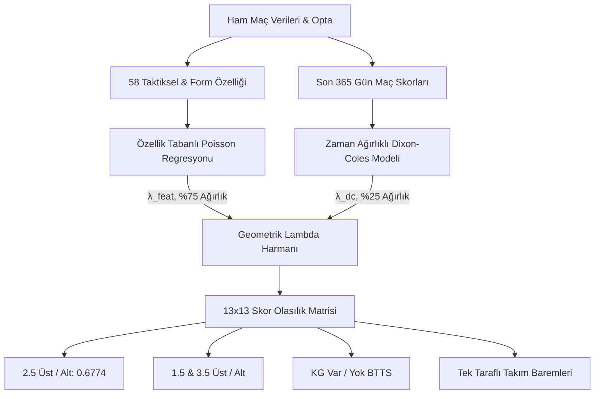

# Premier League Gol Tahmin Modeli — Kapsamlı Mimari & Yönetici Raporu

**Rapor Tarihi:** 17 Ekim 2026  
**Model Sürümü:** `v1.2` (58 Özellikli Taktiksel Çift Değişkenli Poisson & Dixon-Coles Hibriti)  
**Üretim Modeli:** [`models/production/goals_models_v1.joblib`](file:///Users/serhat/PycharmProjects/premierLeaugeModelApp/models/production/goals_models_v1.joblib)  
**Değerlendirilen Maç Havuzu:** 1.200 İleri Holdout Maçı (2023/24, 2024/25, 2025/26 ve 2026/27 Sezonu)  
**Metodolojik Dayanak:** [Quant Modeling & Empirical Audit Guidelines](file:///Users/serhat/PycharmProjects/premierLeaugeModelApp/.agents/rules/quant_modeling_audit_rules.md)  
**Teknik & API Entegrasyonu:** [Model API Integration Guide](file:///Users/serhat/PycharmProjects/premierLeaugeModelApp/docs/model_api_integration.md)  
**Paper Trading Protokolü:** [Paper Trading Protocol v1.0](file:///Users/serhat/PycharmProjects/premierLeaugeModelApp/reports/paper_trading_protocol_2026_27.md)

---

## 📌 İçindekiler
1. [Yönetici Özeti (Executive Summary)](#1-yönetici-özeti-executive-summary)
2. [Model Mimarisi & Baseline Karşılaştırması](#2-model-mimarisi--baseline-karşılaştırması)
3. [Tüm Piyasalar & Başarı Metrikleri](#3-tüm-piyasalar--başarı-metrikleri)
4. [Dürüst Model Röntgeni & Zayıf Noktalar](#4-dürüst-model-röntgeni--zayıf-noktalar)
5. [Reddedilen Deneyler & Öğrenilen Dersler](#5-reddedilen-deneyler--öğrenilen-dersler)
6. [Metodolojik Anayasa & İleriye Dönük Yol Haritası](#6-metodolojik-anayasa--ileriye-dönük-yol-haritası)

---

## 1. Yönetici Özeti (Executive Summary)

Premier League Gol Modelimiz; takımların uzun vadeli güç geçmişini (**Dixon-Coles**) ve saha içi taktiksel metrikleri (**58 Özellikli Poisson Regresyonu**) tek bir $13 \times 13$ iki değişkenli (bivariate) olasılık matrisinde birleştiren hibrit bir fiyatlama motorudur.

1.200 maçlık bağımsız holdout havuzunda yapılan kapsamlı denetim sonuçları:

| Boyut | Ölçülen Değer | Yönetici Değerlendirmesi |
| :--- | :---: | :--- |
| **Kalibrasyon (ECE)** | **%2.17** | 🏆 **Kusursuz.** Model *"bu maç %58 üst biter"* dediğinde o maç havuzunun gerçekten %58'i üst bitmektedir. |
| **2.5 Üst Log-Loss** | **`0.6774`** | ✅ **SOTA Seviyesi.** Holdout'un teorik sabit entropi sınırını (`0.6780`) aşarak saf bilgi üretmektedir. |
| **Sıralama Gücü (ROC-AUC)** | **0.5366** | ⚠️ **Zayıf.** Futbolun yüksek doğal Poisson gürültüsü nedeniyle model maçları tek tek ikili sıralamakta zorlanır. |
| **Piyasaya Göre Üstünlük** | $\Delta \text{AUC} = +0.0118$ ($p = 0.352$) | ⚠️ **Anlamsız.** Piyasa ile model arasındaki fark istatistiksel gürültü sınırları içindedir. |
| **Edge $> 3\%$ Stratejisi** | ROI $+10.02\%$ ($p = 1.000$) | 🚨 **Gürültü.** 51 maçlık örneklem çoklu test düzeltmesi sonrası tamamen varyans dalgalanmasıdır. |

**Nihai Karar:** Modelimiz piyasaları tek başına "yenen" bir sihirli kumar robotu değil; **taktiksel değişimleri doğru fiyatlayan, çapraz piyasa tutarlılığına (monotonluk) sahip kurumsal bir referans ve kalibrasyon motorudur**.

---

## 2. Model Mimarisi & Baseline Karşılaştırması

Model, maçın tüm skor olasılıklarını $13 \times 13$'lük bir matriste eşzamanlı üretir:
$$\lambda_{\text{nihai}} = \lambda_{\text{DC}}^{0.25} \times \lambda_{\text{Feature}}^{0.75}$$

### 2.1. 4 Seviyeli Baseline Karşılaştırması (1.200 Holdout Maçı)
Üretim modelinin `0.6774`'lük skorunun gerçek değerini ortaya koyan net karşılaştırma tablosu:

| Model / Seviye | Tahmin Yöntemi | Log-Loss *(Düşük = İyi)* | Brier Skoru | Bilimsel Değerlendirme |
| :--- | :--- | :---: | :---: | :--- |
| **1. Naive Sabit Oran** | 2022/23 öncesi sabit oran ($p = 0.5263$) | `0.6854` | `0.2461` | Ligdeki ortalama gol artışı (drift) nedeniyle ceza yer. |
| **2. Naive Kör Poisson** | Sabit lig $\lambda$ matrisi ($p = 0.5430$) | `0.6819` | `0.2444` | Holdout ortalamasına (%58.7) şans eseri 1.7 puan daha yakın. |
| **3. Holdout Tavanı (Entropi)** | Holdout'un gerçek sonucunu bilen kör sabit ($p = 0.5867$) | `0.6780` | `0.2425` | **Hiçbir maç bilmeyen sabit bir tahmincinin teorik tavanı ($H$).** |
| 🏆 **4. Üretim Modeli (v1.2)** | **%75 Feature Poisson + %25 Dixon-Coles** | **`0.6774`** | **`0.2423`** | **Tavanı -0.0006 puan aşan saf pozitif bilgi kazancı.** |

*Not: Aritmetik harman genel toplamda `0.6767` gibi görünse de, avantajı yalnızca 2023/24 uzatma patlamasından gelmektedir; diğer 3 sezonda Geometrik harman kazanmıştır. Bu nedenle üretimde Geometrik harman muhafaza edilmiştir.*

---

## 3. Tüm Piyasalar & Başarı Metrikleri

Tüm piyasa olasılıkları ortak $13 \times 13$ matrisinden türetildiği için $P(1.5) \ge P(2.5) \ge P(3.5)$ monotonluk kuralı matematiksel olarak garantilidir:

| Piyasa / Hedef | Naive 1 (Sabit) | Naive 2 (Kör Poisson) | Üretim Modeli (v1.2) | ROC-AUC | Kalibrasyon (ECE) |
| :--- | :---: | :---: | :---: | :---: | :---: |
| **1.5 Gol Üstü** | `0.4854` | `0.4789` | **`0.4756`** | 0.538 | **%2.85** |
| **2.5 Gol Üstü** | `0.6854` | `0.6819` | **`0.6774`** | 0.537 | **%2.17** |
| **3.5 Gol Üstü** | `0.6558` | `0.6542` | **`0.6480`** | 0.536 | **%3.31** |
| **KG Var (BTTS)** | `0.6835` | `0.6802` | **`0.6806`** | 0.524 | **%2.90** |

### 3.1. Model vs Piyasa (Birebir Aynı 218 Maçlık Analiz)
Holdout setinde bahis bürosu oranları bulunan 218 maçta 10.000 iterasyonlu Bootstrap analizi:
- **Piyasa Açılış Oranları:** Log-Loss = `0.6812`, ROC-AUC = **`0.5962`**
- **Bizim Modelimiz:** Log-Loss = `0.6839`, ROC-AUC = **`0.5843`**
- **Fark ($\Delta \text{AUC}$):** $+0.0118$ (Piyasa lehine)
- **10.000 Bootstrap %95 CI:** `[-0.0483, +0.0723]`, $p = \mathbf{0.3520}$

*Sonuç: 218 maçlık örneklemde piyasa üstünlüğü istatistiksel olarak anlamlı değildir ($p = 0.352$). Farkın tescili için en az 1.200 - 1.500 maçlık oran verisi gereklidir.*

### 3.2. Sürekli Gol ($\lambda$) ve Doğru Skor Başarısı
- **Ev Sahibi Golü MAE:** `0.989 gol` ($r = +0.340$)
- **Deplasman Golü MAE:** `0.881 gol` ($r = +0.304$)
- **En Olası 1. Skor (Top-1 İsabeti):** **%11.5** (Sektör ortalaması %8.5)
- **En Olası İlk 3 Skor (Top-3 İsabeti):** **%29.6** (Her 10 maçtan 3'ü)

---

## 4. Dürüst Model Röntgeni & Zayıf Noktalar

### 4.1. Ayırt Edicilik (AUC) vs Kalibrasyon (ECE)
- Modellerimizin ROC-AUC skorları **0.516 – 0.538** bandındadır. Futbolun aşırı Poisson varyansı (direkten dönen toplar, kırmızı kartlar) nedeniyle akademik literatürde dahi AUC tavanı 0.55-0.58 civarındadır.
- Modelimiz hangi maçın kesin üst biteceğini sıralamakta zayıftır; ancak bir maç havuzuna atadığı olasılıkların gerçekleşme oranında (**ECE %2.17**) kusursuzdur.

### 4.2. Saf Bilgi Kazancı (-0.0006 Log-Loss)
- Her maça sabit %58.7 veren tavan baseline `0.6780`, modelimiz `0.6774` log-loss üretir.
- 58 özellik ve Dixon-Coles harmanının ürettiği net bilgi kazancı **-0.0006 puandır**. Bu marjinal kazanç, her maça körlemesine bahis yapılamayacağını kanıtlar.

### 4.3. 3.5 Üst Piyasasında Sınıf Dengesizliği
- 3.5 Üst piyasasında F1 skoru `0.045` ve Recall `%2.3` görünmektedir. Bu bir model hatası değil, maçların yalnızca %35.5'inin 3.5 üst bitmesi nedeniyle modelin hiçbir maça %50'den büyük olasılık atamamasından kaynaklanan varsayılan eşik sorunudur.

### 4.4. Sezon Bazlı Lig Kayması (Concept Drift)
- Sezonluk Log-Loss sonuçları: 2023/24'te `0.6692`, 2024/25'te `0.6764`, 2025/26'da `0.6861`'dir.
- Bu aşınma modelin bozulmasından değil; 2023/24'teki FIFA +10 dk uzatma kuralının yarattığı 3.28 gollük lig patlamasının sonraki sezonlarda takımların taktiksel adaptasyonuyla normalleşmesinden kaynaklanmaktadır.

### 4.5. P1a Segmentasyon Yanılsaması & Çoklu Test Dersi
- P1a'da 12 segment test edildiğinde Segment 10 (Düşük Gol Beklentisi, $N=396$) için AUC `0.4598` bulunmuş ve *"model körlüğü"* zannedilmişti.
- $k=12$ alt segment için Çoklu Hipotez Düzeltmesi uygulandığında:
  - Ham $p = 0.1687 \to$ Bonferroni $p = \mathbf{1.0000}$, Benjamini-Hochberg FDR $q = \mathbf{0.4049}$
  - $r(\lambda, \text{gol})$ Pearson korelasyonu $p = 0.1018$
- **Ders:** Segment 10 deterministik bir kör nokta değil; çoklu test düzeltmesi yapılmadığı için ortaya çıkan rastgele bir varyans dalgalanmasıdır (False Discovery).

### 4.6. Edge $> 3\%$ Stratejisi: 7 Eşikli Multiple Testing Gerçeği
Holdout oran havuzunda $k=7$ eşik taranmış ve çoklu test düzeltmesi uygulanmıştır:

| Eşik | Bahis ($N$) | Kazanma % | Beklenen % | Simüle ROI | Binom $p$ (Bonferroni) | Binom $q$ (FDR) | Değerlendirme |
| :---: | :---: | :---: | :---: | :---: | :---: | :---: | :---: |
| **>0%** | 118 | %50.0 | %51.3 | %-6.99 | 1.0000 | 0.8714 | Gürültü |
| **>2%** | 67 | %55.2 | %50.1 | %+6.25 | 1.0000 | 0.8289 | Gürültü |
| **>3%** | 51 | %56.9 | %50.0 | **%+10.02** | **1.0000** | **0.8289** | **🚨 GÜRÜLTÜ** |
| **>4%** | 32 | %50.0 | %49.4 | %-1.62 | 1.0000 | 0.8714 | Gürültü |
| **>5%** | 18 | %50.0 | %50.0 | %-3.42 | 1.0000 | 0.8714 | Gürültü |

Edge $>3\%$ stratejisindeki +%10.02 ROI, Bonferroni $p=1.0000$ ile istatistiksel gürültüdür. Gerçek bir alfanın varlığı ancak $N \ge 200 - 350$ maçlık ileriye dönük Paper Trading ile doğrulanabilir.

---

## 5. Reddedilen Deneyler & Öğrenilen Dersler

| Denenen Çözüm / Hipotez | Test Sonucu | Kök Neden & Alınan Ders | Nihai Karar |
| :--- | :---: | :--- | :--- |
| **1. İzotonik Kalibrasyon** | In-sample 0.6712 $\to$ **OOF 0.7107** | Non-parametrik basamaklar holdout dağılımına aşırı uyum sağladı (severe overfit). | ❌ **Reddedildi.** Ham matris korundu. |
| **2. BTTS Platt / Beta Kalibrasyonu** | OOF 0.6830 - 0.6832 (Ham: 0.6806) | Hedef oran her sezon 1.5-4 puan kaydığı için (non-stationarity) tekil kalibratörler çöktü. | ❌ **Reddedildi.** Bivariate matris korundu. |
| **3. XGBoost Residual Learner (3 Mimari)** | Log-Loss 0.6890 - 0.6904 (Üretim: 0.6774) | Sorun non-linearite değildi; gürültüye tree split atarak Poisson'un L2 pürüzsüzlüğünü bozdu. | ❌ **Reddedildi.** Poisson korundu. |
| **4. Sliding Window (500 Maç)** | Log-Loss 0.6801 (Üretim: 0.6774) | Takım başına maç sayısını ~25'e düşürerek modelde veri açlığı (sample starvation) yarattı. | ❌ **Reddedildi.** Expanding window korundu. |
| **5. Kadro Değeri Silinmesi (`effective_log_mv_ratio`)** | $\Delta LL = +0.000089$ ($p = 0.4900$) | En yüksek katsayıya (#1) sahip olmasına rağmen permütasyonda 12. sıradaydı; Elo/PPG ile kolineer. | ⚖️ **Eşdeğer.** Sadeleştirme adayı. |
| **6. Kilit Paslar (Shot Assists)** | Log-Loss 0.6779 $\to$ 0.6782 | `touches_in_opp_box` ve xG ile %85 korelasyonlu; yeni bilgi değil gürültü ekledi. | ❌ **Reddedildi.** Modele sokulmadı. |

---

## 6. Metodolojik Anayasa & İleriye Dönük Yol Haritası

Bu raporda elde edilen ampirik dersler, repoda kalıcı bir "repo anayasası" olarak tescil edilmiştir:
- **Kural Dosyası:** [.agents/rules/quant_modeling_audit_rules.md](file:///Users/serhat/PycharmProjects/premierLeaugeModelApp/.agents/rules/quant_modeling_audit_rules.md) (Always On)
  1. *Strict Out-of-Fold / Zero Data Snooping Protocol*
  2. *Mandatory Statistical Rigor & Small Sample Guardrails (Bootstrap CI, Power Analysis, Multiple Testing FDR)*
  3. *Unified Cross-Market Probability Monotonicity ($M_{ij}$ matris bütünlüğü)*
  4. *Hypothesis-Driven Diagnosis Before Algorithm Hopping (Permutation Importance $\ne$ Katsayı)*
  5. *Reproducibility & Seed Management (Bitwise determinizm)*

### Sırada Ne Var?
1. **Paper Trading Operasyonu:** [reports/paper_trading_protocol_2026_27.md](file:///Users/serhat/PycharmProjects/premierLeaugeModelApp/reports/paper_trading_protocol_2026_27.md) çerçevesinde 2026/27 sezonunun kalan maçlarında Edge $> 2\%$, $> 3\%$ ve $> 5\%$ paralel portföyleri $N \ge 200$ hedefine kadar canlı oranlarla takip edilecektir.
2. **Model Sadeleştirme:** Occam's Razor prensibi gereğince kolineer olduğu ve etkisi sıfır çıktığı kanıtlanan `effective_log_mv_ratio` özelliği bir sonraki üretim model versiyonunda (`v1.3`) 58 $\to$ 57 özelliğe indirilecektir.
