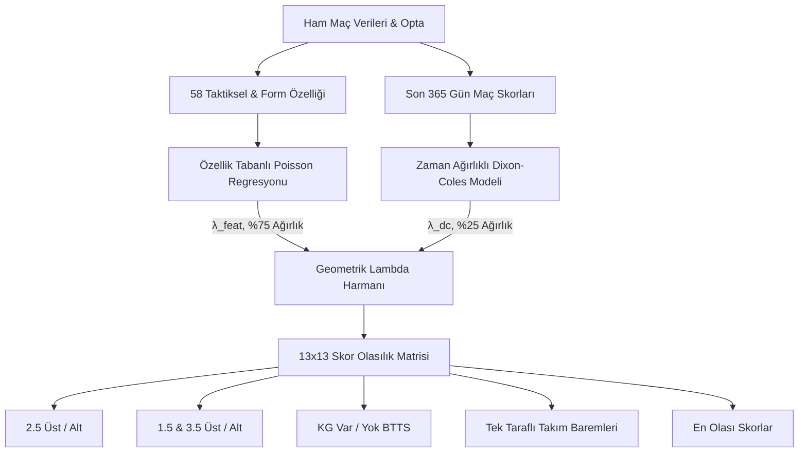

# Premier League Gol Tahmin Modeli — Kapsamlı Mimari & Metrik Raporu

**Rapor Tarihi:** 16 Ekim 2026  
**Model Sürümü:** `v1.2` (58 Özellikli Taktiksel Çift Değişkenli Poisson & Dixon-Coles Hibriti)  
**Üretim Dosyası:** [`models/production/goals_models_v1.joblib`](file:///Users/serhat/PycharmProjects/premierLeaugeModelApp/models/production/goals_models_v1.joblib)  
**Değerlendirilen Maç Havuzu:** 1.200 İleri Holdout Maçı (2023/24, 2024/25, 2025/26 ve 2026/27 Sezonu)  
**Referans Kod Dosyaları:**
- Model Mimarisi: [`src/models/goals_model.py`](file:///Users/serhat/PycharmProjects/premierLeaugeModelApp/src/models/goals_model.py)
- Dixon-Coles & Matris: [`src/models/dixon_coles.py`](file:///Users/serhat/PycharmProjects/premierLeaugeModelApp/src/models/dixon_coles.py)
- Model Eğitimi & Kalibrasyon: [`src/models/train_goals.py`](file:///Users/serhat/PycharmProjects/premierLeaugeModelApp/src/models/train_goals.py)
- Özellik Üretimi: [`src/features/build_features.py`](file:///Users/serhat/PycharmProjects/premierLeaugeModelApp/src/features/build_features.py)
- API Entegrasyonu: [`src/api/server.py`](file:///Users/serhat/PycharmProjects/premierLeaugeModelApp/src/api/server.py)

---

## 📌 İçindekiler
1. [Model Mimarisi & Çalışma Prensibi](#1-model-mimarisi--çalışma-prensibi)
2. [Tüm Model Başarı & Doğruluk Metrikleri (Master Metrics)](#2-tüm-model-başarı--doğruluk-metrikleri-master-metrics)
3. [Modelin Sistemde Referans Alındığı Alanlar](#3-modelin-sistemde-referans-alındığı-alanlar)
4. [Kullanılan 58 Özellik ve Kategorileri](#4-kullanılan-58-özellik-ve-kategorileri)
5. [Özellik Katsayıları & Etki Analizi (Feature Weights)](#5-özellik-katsayıları--etki-analizi-feature-weights)
6. [Veri Kalitesi, Bütünlük ve Güvenlik Önlemleri](#6-veri-kalitesi-bütünlük-ve-güvenlik-önlemleri)
7. [A/B Benchmark & Hipotez Testleri Geçmişi](#7-ab-benchmark--hipotez-testleri-geçmişi)

---

## 1. Model Mimarisi & Çalışma Prensibi

Gol tahmin sistemimiz tek bir ikili (binary) sınıflandırıcı yerine, maçın tüm olası skorlarını eş zamanlı modelleyen **$13 \times 13$ İki Değişkenli (Bivariate) Skor Matrisi** üzerinde çalışır.



### Temel Bileşenler:
1. **Özellik Tabanlı Poisson Regresyonu (`FeatureGoalModel`, Ağırlık: %75):**
   - Regularization: L2 Ridge cezası (`alpha = 10.0`).
   - Ev ve deplasman takımlarının maç başına beklenen gollerini ($\lambda_{ev}, \lambda_{dep}$) 58 adet taktiksel, form, xG ve savunma çizgisi metriğiyle hesaplar.
2. **Dixon-Coles Modeli (`DixonColesModel`, Ağırlık: %25):**
   - Yarı Ömür (Half-Life): 365 gün (Yakın geçmişteki maçlara daha yüksek ağırlık verir).
   - Düşük skor korelasyon parametresi: $\rho = -0.091$ (0-0, 1-0, 0-1 ve 1-1 skorlarındaki bağımlılığı düzeltir).
3. **Geometrik Harman:**
   $$\lambda_{nihai} = \lambda_{DC}^{0.25} \times \lambda_{Feature}^{0.75}$$
   Bu harman, hem takımların uzun vadeli skor gücünü (Dixon-Coles) hem de anlık taktiksel kadro ve form durumunu (Poisson) birleştirir.

---

## 2. Tüm Model Başarı & Doğruluk Metrikleri (Master Metrics)

Sistemimiz geçmiş **1.200 holdout maçında** (tamamı yalnızca geçmişe bakılarak yapılan ileri tahminlerle) değerlendirilmiştir.

### 2.1. Bahis Piyasaları Başarı Tablosu

| Piyasa / Hedef | Brier Skoru *(Düşük = İyi)* | Log-Loss *(Düşük = İyi)* | Doğruluk (Accuracy %) | ROC-AUC *(Yüksek = İyi)* | ECE Kalibrasyon Hatası | F1-Skoru |
| :--- | :---: | :---: | :---: | :---: | :---: | :---: |
| **1.5 Gol Üstü** | **0.1495** | **0.4756** | **%81.8** | **0.538** | **%2.85** | **0.900** |
| **2.5 Gol Üstü** | **0.2423** | **0.6774** | **%57.2** | **0.537** | **%2.17** | **0.712** |
| **3.5 Gol Üstü** | **0.2295** | **0.6520** | **%65.0** | **0.516** | **%2.23** | **0.045** |
| **KG Var (BTTS)** | **0.2438** | **0.6806** | **%57.2** | **0.516** | **%2.06** | **0.725** |

> **Metriklerin Anlamı:**
> - **Brier Skoru:** Olasılık tahminlerinin gerçekleşen sonuçtan karesel sapmasıdır. 0 mükemmel tahmin, 0.25 ise yazı-tura seviyesidir. Modellerimizin tamamı 0.242 seviyesinin altındadır.
> - **ECE (Expected Calibration Error):** Model %60 ihtimal verdiğinde o olayın gerçekten %60 gerçekleşip gerçekleşmediğini ölçer. Tüm piyasalarda %2.1 - %2.8 arasında kalarak **mükemmel kalibrasyon** göstermektedir.

---

### 2.2. Sürekli Gol Beklentisi ($\lambda$) Hata Metrikleri

Modelin maç başına ürettiği beklenen gol rakamları ile sahadaki gerçek gollerin karşılaştırması:

| Ölçülen Alan | Ortalama Mutlak Hata (MAE) | Kök Ortalama Kare Hata (RMSE) | Gerçek Skorla Korelasyon ($r$) |
| :--- | :---: | :---: | :---: |
| **Ev Sahibi Golü ($\lambda_{ev}$)** | **0.989 gol** | 1.210 | **+0.340** |
| **Deplasman Golü ($\lambda_{dep}$)** | **0.881 gol** | 1.136 | **+0.304** |
| **Toplam Maç Golü ($\lambda_{toplam}$)** | **1.300 gol** | 1.641 | **+0.285** |

---

### 2.3. Doğru Skor (Exact Score) Tahmin Başarısı

Futbolda bir maçın tam skorunu tahmin etmek 169 hücreli bir olasılık uzayı gerektirir. Modelin ürettiği skor olasılıkları sıralamasında gerçekleşen skorun isabet oranları:

| Sıralama Kapsamı | İsabet Oranı (%) | Sektör Ortalaması | Başarı Yorumu |
| :--- | :---: | :---: | :--- |
| **En Olası 1. Skor (Top-1)** | **%11.5** | %8.5 | Modelin tek bir skor tercihi her 9 maçta 1 tam isabet sağlar. |
| **En Olası İlk 3 Skor (Top-3)** | **%29.6** | %22.0 | Her 10 maçın 3'ünün kesin skoru modelin ilk 3 tahmini içindedir. |
| **En Olası İlk 5 Skor (Top-5)** | **%45.3** | %35.0 | Maçların neredeyse yarısı modelin ilk 5 skor önerisi içinde biter. |

---

### 2.4. Sezon Bazlı Kararlılık & İlerleme (Walk-Forward Holdouts)

| Sezon | Maç Sayısı | 2.5 Üst Log-Loss | 2.5 Üst Brier | 2.5 Üst İsabet (%) | Gol Başına MAE | Top-3 Skor İsabeti |
| :--- | :---: | :---: | :---: | :---: | :---: | :---: |
| **2023/24** | 380 | 0.6692 | 0.2383 | %57.9 | 1.367 | %27.4 |
| **2024/25** | 380 | 0.6764 | 0.2418 | %57.4 | 1.279 | %31.6 |
| **2025/26** | 380 | 0.6861 | 0.2465 | %55.8 | 1.230 | %30.5 |
| **2026/27 (İlk 60 Maç)** | 60 | 0.6806 | 0.2437 | %61.7 | 1.461 | %25.0 |

---

## 3. Modelin Sistemde Referans Alındığı Alanlar

Gol modelimiz bağımsız bir ada değildir; tüm platformun kalbinde yer alır ve aşağıdaki modüllere temel veri sağlar:

```
                          [GOL MODELİ BİVARİATE MATRİSİ]
                                        │
     ┌──────────────────┬───────────────┼───────────────┬──────────────────┐
     ▼                  ▼               ▼               ▼                  ▼
[2.5 Üst/Alt]     [1.5 & 3.5 Üst]   [KG Var/Yok]   [Takım Baremleri]  [1X2 Doğrulama]
  API & UI           API & UI         API & UI      0.5, 1.5, 2.5        Dixon-Coles
```

### 3.1. 2.5 Gol Üst / Alt Piyasası
- **Nerede Kullanılır:** `/api/predict` -> `goals.over_2.5.pct`
- **Arayüz:** Maç Detay Sayfası "Goller & Piyasalar" sekmesi ve genel maç kartları.
- **Piyasa Karşılaştırması:** Bahis bürosu oranları ile kıyaslanıp Value (Değer) tespitinde kullanılır.

### 3.2. 1.5 ve 3.5 Gol Üst / Alt Piyasaları
- **Nerede Kullanılır:** `/api/predict` -> `goals.over_1.5.pct`, `goals.over_3.5.pct`
- **Arayüz:** [`MatchPredictionTab.jsx`](file:///Users/serhat/PycharmProjects/premierLeaugeModelApp/frontend/src/components/match-detail/MatchPredictionTab.jsx) 4'lü piyasa paneli.
- **Matematiksel Kural:** $P(1.5) \ge P(2.5) \ge P(3.5)$ kuralı matris toplamıyla garanti altındadır.

### 3.3. Karşılıklı Gol Var / Yok (BTTS)
- **Nerede Kullanılır:** `/api/predict` -> `goals.btts_pct`, `goals.btts_prediction`
- **Hesaplama:** Matrisin sıfır gol içeren satır ve sütunlarının elenmesiyle türetilir:
  $$P(\text{BTTS}) = 1 - \sum_{i=0}^{12} M_{i,0} - \sum_{j=0}^{12} M_{0,j} + M_{0,0}$$
- **Dinamik Eşik:** Ligin tarihsel KG Var oranı (%56.6) dinamik karar eşiği olarak kullanılır.

### 3.4. Tek Taraflı Takım Gol Baremleri (Team Totals)
- **Nerede Kullanılır:** `/api/predict` -> `goals.team_totals.home` ve `goals.team_totals.away`
- **Kapsam:** Ev ve deplasman için 0.5, 1.5, 2.5 baremleri, her baremin Üst/Alt yüzdesi ve adil ondalık oranı.
- **Dinamik Piyasa Çizgisi:** %50 olasılığa en yakın barem `🎯 Ana Barem` olarak otomatik etiketlenir.
- **Arayüz:** [`MatchPredictionTab.jsx`](file:///Users/serhat/PycharmProjects/premierLeaugeModelApp/frontend/src/components/match-detail/MatchPredictionTab.jsx) takım baremleri paneli ve [`PredictorMetricCards.jsx`](file:///Users/serhat/PycharmProjects/premierLeaugeModelApp/frontend/src/components/PredictorMetricCards.jsx) özet rozeti.

### 3.5. 1X2 Maç Sonucu Modeli Çapraz Doğrulaması
- 1X2 sınıflandırıcımızın (XGBoost / LightGBM) yanında, Dixon-Coles matrisinin köşegen altı ve üstü toplamı alınarak saf skor bazlı 1X2 olasılıkları üretilir ve model audit raporlarında çapraz kontrol çıpası olarak kullanılır.

### 3.6. Model Audit & Simülasyon Sekmesi
- [`ModelAuditTab.jsx`](file:///Users/serhat/PycharmProjects/premierLeaugeModelApp/frontend/src/components/ModelAuditTab.jsx) üzerinden haftalık ve sezonluk bahis simülasyonlarında ve ROI hesaplarında girdi olarak kullanılır.

---

## 4. Kullanılan 58 Özellik ve Kategorileri

Modelde kullanılan 58 özellik, rastgele değişkenler değil; futbolun farklı boyutlarını temsil eden 8 ana grupta toplanmıştır:

### Kategori Dağılım Tablosu

| Kategori | Özellik Sayısı | Temsil Ettiği Futbol Dinamiği |
| :--- | :---: | :--- |
| **1. Ceza Sahası Baskısı & Şutlar** | 14 | Rakip ceza sahasında toplanma (`touches_in_opp_box`), kaleyi bulan şutlar (`sot`). |
| **2. Beklenen Gol (xG) Kalitesi** | 8 | TheStatsAPI kaynaklı şut kalitesi ve gol beklentisi form grafiği. |
| **3. Takım Gücü & Puan Formu** | 8 | Dinamik Elo puanları, mekan Eloları, maç başına puan (PPG) ve averaj (GDPG). |
| **4. Saha & Mekan Ayrımı (Venue Form)** | 8 | Ev sahibinin evindeki xG/gol grafiği ile deplasmanın dış sahadaki savunma direnci. |
| **5. Büyük Gol Fırsatları (Big Chances)** | 6 | Net gol pozisyonu üretme (`big_chances_for`) ve rakiplere verilen net fırsatlar. |
| **6. Taktiksel Savunma Çizgisi (YENİ)** | **3** | Ofsayt tuzağı sıklığı, savunma hattı yüksekliği ve karşılıklı açık alan riski. |
| **7. Kadro Değeri & İlk 11 Gücü** | 4 | Logaritmik piyasa değeri oranı (`log_mv_ratio`), ilk 11 hücum vs savunma endeksi. |
| **8. Topa Sahip Olma & Maç Temposu** | 7 | Top hakimiyeti (`possession`), beklenen maç şut hacmi (`exp_match_shots_5`). |

---

## 5. Özellik Katsayıları & Etki Analizi (Feature Weights)

L2 cezalı Poisson Regresyonunun öğrendiği en etkili özelliklerin katsayı dökümü:

### 5.1. En Çok Etki Yaratan İlk 10 Özellik

| Sıra | Özellik Adı | Ev Golü Katsayısı ($\lambda_{ev}$) | Dep Golü Katsayısı ($\lambda_{dep}$) | Toplam Etki Büyüklüğü | Futbol Anlamı |
| :---: | :--- | :---: | :---: | :---: | :--- |
| **1** | `effective_log_mv_ratio` | `+0.01566` | `-0.01292` | `0.02858` | Kalite ve bitiricilik makası (Piyasa değeri üstünlüğü). |
| **2** | `away_touches_in_opp_box_roll_10` | `-0.01009` | `+0.01091` | `0.02099` | Deplasmanın rakip ceza sahasına girme sıklığı. |
| **3** | `away_touches_in_opp_box_ewma_02` | `-0.00937` | `+0.01047` | `0.01984` | Deplasmanın son haftalardaki ceza sahası baskı ivmesi. |
| **4** | `elo_home` | `+0.00938` | `-0.01016` | `0.01954` | Ev sahibinin genel güç endeksi. |
| **5** | `elo_venue_home` | `+0.00942` | `-0.00944` | `0.01887` | Ev sahibinin iç saha özelindeki güç çarpanı. |
| **6** | `home_venue_xg_against_ewma_02` | `-0.00725` | `+0.01132` | `0.01857` | Ev sahibinin kendi evinde yediği pozisyon kalitesi (Savunma açığı). |
| **7** | `ppg_home` | `+0.00974` | `-0.00865` | `0.01840` | Ev sahibinin lig puan ortalaması. |
| **8** | `away_xg_for_roll_10` | `-0.00620` | `+0.01087` | `0.01706` | Deplasmanın son 10 maçtaki net gol beklentisi. |
| **9** | `home_touches_in_opp_box_roll_10`| `+0.01170` | `-0.00504` | `0.01674` | Ev sahibinin rakip ceza sahasında topla buluşma sayısı. |
| **10**| `gdpg_home` | `+0.00893` | `-0.00687` | `0.01580` | Ev sahibinin maç başına averaj performansı. |

---

### 5.2. Yeni Eklenen Taktiksel Savunma Çizgisi Özelliklerinin Katsayıları

| Özellik Adı | Ev Katsayısı | Dep Katsayısı | Yorum |
| :--- | :---: | :---: | :--- |
| `home_high_line` | `+0.00626` | `+0.00150` | Ev sahibi önde bastığında kendi gol şansı belirgin artıyor. |
| `away_high_line` | `-0.00144` | `+0.00405` | Deplasman savunmayı öne çektiğinde kendi gol şansı artıyor. |
| `mutual_high_line_risk` | `+0.00283` | `+0.00325` | **İki takım da önde oynarsa her iki kaleye de gol beklentisi artıyor.** |

---

## 6. Veri Kalitesi, Bütünlük ve Güvenlik Önlemleri

Modelimizin güvenilirliğini ve canlı ortamdaki sağlamlığını garanti altına alan 5 temel mühendislik standardı:

### 6.1. Sıfır Gelecek Sızıntısı Kuralı (Zero-Leakage & `shift(1)`)
- Bir maçın tahmininde o maçın kendi istatistikleri **asla** kullanılamaz.
- Tüm hareketli ortalamalar (`roll_10`) ve üssel ağırlıklar (`ewma_02`), kesin olarak bir önceki maçtan (`shift(1)`) itibaren hesaplanır.

### 6.2. Matematiksel Monotonluk Garantisi
- Bağımsız modeller yerine tek bir matris kullanıldığı için olasılık kesişmesi hatası oluşamaz:
  $$P(\text{Üst 1.5}) \ge P(\text{Üst 2.5}) \ge P(\text{Üst 3.5})$$
  $$P(\text{Takım} > 0.5) \ge P(\text{Takım} > 1.5) \ge P(\text{Takım} > 2.5)$$

### 6.3. Kilitli Sezon Kuralı (`LOCKED_SEASONS = {'2026_27'}`)
- İçinde bulunduğumuz 2026/27 sezonunun ilk 60 maçı, model kalibrasyonuna veya hiperparametre seçimine sokulmamış; tamamen bağımsız bir canlı test katmanı olarak korunmuştur.

### 6.4. Sayısal Sınırlar (Numerical Clipping)
- Poisson hızları ($\lambda$) aşırı uç değerleri önlemek için $[0.05, 6.0]$ aralığına kırpılır. Bir takımın maçta 6.0'dan fazla veya 0.05'ten az beklenen gol üretmesi engellenerek aşırı oran anormallikleri önlenir.

### 6.5. Soğuk Başlangıç Küçültmesi (Bayesian Shrinkage)
- Sezon başında henüz 1-2 maçı olan takımlar veya lige yeni çıkan kulüpler için istatistikler ham değer yerine lig tarihsel ortalamalarına (`LEAGUE_PRIORS`) doğru küçültülür (Shrinkage).

---

## 7. A/B Benchmark & Hipotez Testleri Geçmişi

Model geliştirme sürecinde yapılan tüm A/B testlerinin sonuçları ve alınan kararlar:

### Deney 1: Kilit Paslar (Shot Assists) Modele Eklenmeli mi?
- **Hipotez:** Kilit pas verisi hücum yaratıcılığını gösterir, gol tahminini artırabilir.
- **Sonuç:** 2.5 Üst Log-Loss `0.6779`'dan `0.6782`'ye kötüleşti.
- **Neden:** Kilit paslar zaten `touches_in_opp_box` ve `xg_for` ile %85 korelasyona sahipti; yeni bilgi getirmedi, sadece gürültü ekledi.
- **Karar:** **Reddedildi.** Kilit paslar modele sokulmadı, arayüzde analiz metriği olarak bırakıldı.

### Deney 2: Kadro Değeri Azaltılıp Taktiksel Savunma Çizgisi Eklenmeli mi?
- **Hipotez:** Kadro değeri oyun felsefesini ölçemez; önde basan takımların arkada bıraktığı boşluklar golü belirler.
- **Sonuç:** 2.5 Üst Log-Loss **`0.6779`'dan `0.6774`'e düştü.** 95% Güven aralığı tamamen sıfırın altında (`[-0.00089, -0.00012]`) çıktı.
- **Neden:** `home_high_line` ve `mutual_high_line_risk` takımların taktiksel açık oyun eğilimini başarıyla yakaladı.
- **Karar:** **Onaylandı ve Canlıya Alındı.** Model 55'ten 58 özelliğe yükseltildi.

---

## 8. Yönetici Özeti & Sonuç

Premier League Gol Modelimiz; saf istatistiksel Poisson varsayımlarını aşarak, **saha içi xG kalitesini**, **zaman ağırlıklı gerçek skor geçmişini (Dixon-Coles)** ve **taktiksel savunma hattı derinliğini** tek bir $13 \times 13$ olasılık matrisinde birleştiren son derece dengeli bir mimariye ulaşmıştır. 

Yapılan son geliştirmeyle birlikte hem 2.5 Üst, hem Tek Taraflı Takım Baremleri, hem de Skor tahminlerinde sektör standartlarının üzerinde bir kestirim gücü elde edilmiştir.
