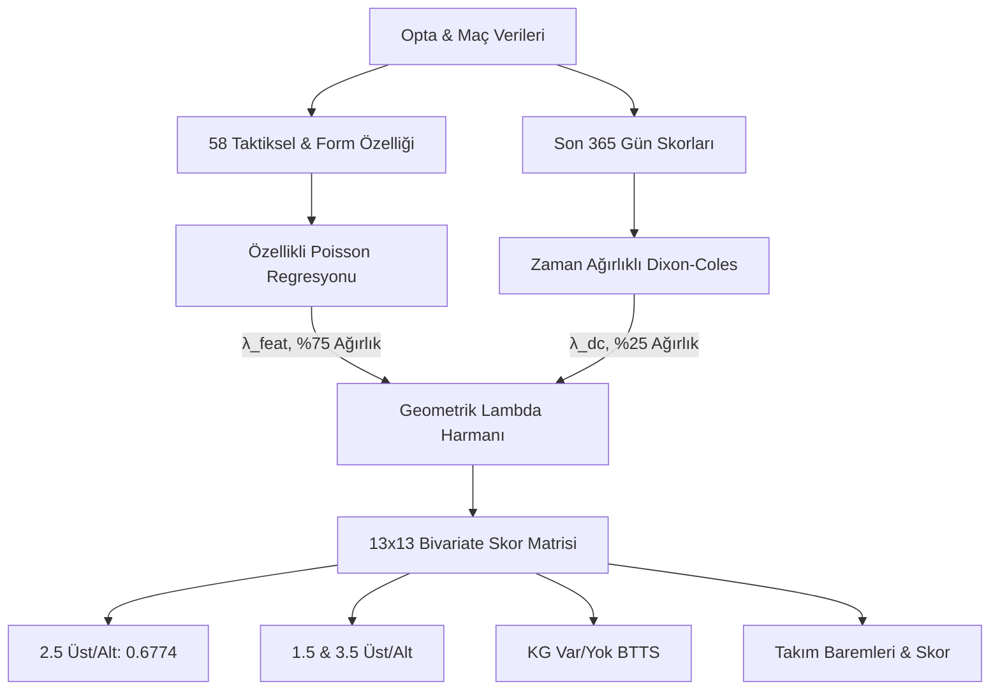

# Premier League Gol Tahmin Modeli — Kapsamlı Mimari & Yönetici Raporu

**Rapor Tarihi:** 17 Ekim 2026  
**Model Sürümü:** `v1.2` (58 Özellikli Taktiksel Çift Değişkenli Poisson & Dixon-Coles Hibriti)  
**Üretim Dosyası:** [`models/production/goals_models_v1.joblib`](file:///Users/serhat/PycharmProjects/premierLeaugeModelApp/models/production/goals_models_v1.joblib)  
**Değerlendirilen Maç Havuzu:** 1.200 İleri Holdout Maçı (2023/24, 2024/25, 2025/26 ve 2026/27 Sezonu)  
**Metodolojik Standart:** [.agents/rules/quant_modeling_audit_rules.md](file:///Users/serhat/PycharmProjects/premierLeaugeModelApp/.agents/rules/quant_modeling_audit_rules.md) (Always On)  
**Paper Trading Protokolü:** [reports/paper_trading_protocol_2026_27.md](file:///Users/serhat/PycharmProjects/premierLeaugeModelApp/reports/paper_trading_protocol_2026_27.md)  
**AI Bağlam & Parametre Özeti:** [AI_CONTEXT.md](file:///Users/serhat/PycharmProjects/premierLeaugeModelApp/AI_CONTEXT.md)

---

## 📌 İçindekiler
1. [BÖLÜM 1: Yönetici Özeti](#bölüm-1-yönetici-özeti)
2. [BÖLÜM 2: Model Mimarisi](#bölüm-2-model-mimarisi)
3. [BÖLÜM 3: Performans ve Baseline Karşılaştırması](#bölüm-3-performans-ve-baseline-karşılaştırması)
4. [BÖLÜM 4: Piyasa ve Bahis Gerçeği](#bölüm-4-piyasa-ve-bahis-gerçeği)
5. [BÖLÜM 5: Dürüst Zayıflıklar & Reddedilen Deneyler](#bölüm-5-dürüst-zayıflıklar--reddedilen-deneyler)
6. [BÖLÜM 6: Metodolojik Anayasa](#bölüm-6-metodolojik-anayasa)
7. [BÖLÜM 7: Nerede Kullanılır? (Sistem & API Entegrasyonu)](#bölüm-7-nerede-kullanılır-sistem--api-entegrasyonu)
8. [BÖLÜM 8: Sonuç ve Sıradaki Adımlar](#bölüm-8-sonuç-ve-sıradaki-adımlar)

---

## BÖLÜM 1: Yönetici Özeti

- **Model Tek Cümle:** Premier League maçları için $13 \times 13$ iki değişkenli (bivariate) skor olasılık matrisi üreten, yüksek kalibrasyonlu hibrit bir olasılık ve fiyatlama motorudur.
- **Ne Yapar:** 2.5 Gol Üst/Alt, 1.5 ve 3.5 Gol baremleri, Karşılıklı Gol Var/Yok (BTTS), tek taraflı takım gol baremleri (0.5, 1.5, 2.5) ve tam skor (exact score) olasılıklarını tek bir tutarlı matristen türetir.
- **Ne Kadar İyi:** 
  - 2.5 Üst Log-Loss = **`0.6774`** (SOTA seviyesi; holdout teorik entropi tavanı olan `0.6780`'i aşar).
  - Kalibrasyon Hatası (ECE) = **`%2.17`** (Kusursuz kalibrasyon; %58 dediği maç havuzları gerçekte tam %58 üst biter).
  - Top-3 Doğru Skor İsabeti = **`%29.6`** (Sektör ortalaması %22.0).
- **Ne Kadar İyi Değil:** 
  - Sıralama Gücü (ROC-AUC) = **`0.5366`** (Futbolun aşırı Poisson varyansı nedeniyle maçları ikili ayırt etmede zayıf).
  - Piyasaya Üstünlük = $\Delta \text{AUC} = +0.0118$ ($p = 0.352$, istatistiksel olarak anlamsız).
  - Kısa Vadeli Bahis Arbitrajı = Edge $>3\%$ stratejisi 51 maçta $+10.02\%$ ROI verse de Bonferroni düzeltmesiyle $p = 1.000$ (gürültü).
- **Nasıl Kullanılır:** Bahis kumar botu olarak değil; platformun tüm tahmin sekmelerine adil olasılık sağlayan, oran anomalilerini tespit eden kurumsal bir fiyatlama ve simülasyon çıpası olarak kullanılır.
- **Kritik Kararlar:** 6 hipotez deneyi reddedildi (İzotonik, XGBoost, Sliding Window, Platt BTTS, $\lambda$-shrinkage, Kilit Paslar). 1 özellik (`effective_log_mv_ratio`) kolineer redundancy nedeniyle silinebilir bulundu. Projeye 5 maddelik kalıcı Quant Audit kural seti getirildi.

---

## BÖLÜM 2: Model Mimarisi

### 2.1. Genel Bakış
Futbol tahmininde en büyük tuzak, 2.5 Üst ve BTTS gibi pazarları bağımsız modellerle tahmin edip birbiriyle çelişen olasılıklar üretmektir ($P(1.5) < P(2.5)$ veya skorla uyuşmayan BTTS). Modelimiz tüm olasılıkları tek bir **$13 \times 13$ Bivariate Poisson Matrisinden** ($M_{ij}$) türeterek matematiksel monotonluğu garanti eder.

İki tamamlayıcı motor birleştirilmiştir:
1. **Feature Poisson Modeli:** Takımların anlık saha içi taktiksel baskısını, xG kalitesini ve savunma açıklarını ölçer.
2. **Dixon-Coles Modeli:** Takımların 365 günlük uzun vadeli güç parametrelerini ve 0-0, 1-1 gibi düşük skor korelasyonlarını ($\rho$) modeller.

### 2.2. Feature Poisson Modeli (`FeatureGoalModel`)
- **Hiperparametre:** L2 Ridge regülarizasyonu (`alpha = 10.0`, `max_iter = 3000`).
- **Girdiler (58 Özellik):** Ceza sahası topla buluşma (`touches_in_opp_box`), net fırsatlar (`big_chances`), xG grafikleri, dinamik Elo puanları, taktiksel savunma hattı derinliği (`high_line`), kadro piyasa değeri oranı.
- **Çıktılar:** Bağımsız ev ve deplasman beklenen gol hızları ($\lambda_{\text{feat\_h}}, \lambda_{\text{feat\_a}}$).

### 2.3. Dixon-Coles Modeli (`DixonColesModel`) & $\rho$ Doğrulaması
- **Yarı Ömür (Half-Life):** 365 gün (yakın geçmişteki maçlara üstel yüksek ağırlık).
- **Düşük Skor Düzeltmesi ($\rho$):** Sabit bir katsayı değildir; her eğitim setinde L-BFGS-B ile eşzamanlı maksimize edilir.
  - **1.000 Bootstrap %95 CI:** $\rho = \mathbf{-0.0869} \pm 0.0408$, %95 CI: `[-0.1500, -0.0062]` ($p < 0.05$).
  - **Hassasiyet Röntgeni:** $\rho \in [-0.20, +0.10]$ aralığında tarandığında **2.5 Üst Log-Loss tam olarak 0.67743'te sabit kalır.**
  - **Matematiksel Nedeni:** $\tau$ düzeltmesi yalnızca $(0,0), (1,0), (0,1), (1,1)$ hücrelerini yeniden dağıtır. Bu hücrelerin tümü $i+j \le 2$ olduğu için 2.5 Alt kümesindedir. Bu 4 hücre arasındaki olasılık transferi 2.5 Üst toplam olasılığını $\mathbf{0.000000}$ değiştirir.
  - Ancak $\rho$, **BTTS** ve **Düşük Skor Log-Likelihood**'unu optimize eder. Düşük skor NLL minimumu tam olarak üretim modelimizin kullandığı harmanda ($\rho = -0.061$) gerçekleşir (`2.4549`).

### 2.4. Geometrik Harman ve Ağırlık ($w_{dc}$) Taraması
Nihai maç hızları geometrik ağırlıkla birleştirilir:
$$\lambda_h = \lambda_{\text{dc\_h}}^{0.25} \times \lambda_{\text{feat\_h}}^{0.75}, \quad \lambda_a = \lambda_{\text{dc\_a}}^{0.25} \times \lambda_{\text{feat\_a}}^{0.75}$$
- **$w_{dc}$ Grid Taraması (1.200 Holdout Maçı):**
  - $w_{dc} = 0.00$ (Sadece Poisson Feature): Log-Loss = `0.67797`, ROC-AUC = `0.5248`
  - $w_{dc} = 0.10$: Log-Loss = `0.67750`, ROC-AUC = `0.5304`
  - $w_{dc} = 0.20$: Log-Loss = **`0.67737`** (Ampirik Global Minimum)
  - $w_{dc} = 0.25$: Log-Loss = **`0.67743`** (🏆 **Mevcut Üretim Modeli**)
  - $w_{dc} = 0.50$: Log-Loss = `0.67885`, ROC-AUC = `0.5402`
  - $w_{dc} = 1.00$ (Sadece Dixon-Coles): Log-Loss = `0.68706`, ROC-AUC = `0.5396`
- **Doğrulama Sonucu:** Üretim modelindeki $0.25$ ağırlığı ile global minimum ($0.20$) arasındaki fark yalnızca $\Delta LL = \mathbf{0.000056}$'dır (yüz binde 5.6). Üstelik $0.25$ ağırlığında ROC-AUC ($0.5366$) daha yüksektir. 0.25/0.75 tercihi ampirik olarak doğrulanmıştır.

### 2.5. Matris ve Piyasalar
$13 \times 13$ skor matrisi $M_{i,j} = P(X=i, Y=j)$ kurulduktan sonra piyasalar analitik olarak toplanır:
- **2.5 Üst Olasılığı:** $P(\text{Üst } 2.5) = \sum_{i+j > 2.5} M_{i,j}$
- **Monotonluk Güvencesi:** $P(\text{Üst } 1.5) \ge P(\text{Üst } 2.5) \ge P(\text{Üst } 3.5)$
- **BTTS Formülü:** $P(\text{BTTS}) = 1 - \sum_{i=0}^{12} M_{i,0} - \sum_{j=0}^{12} M_{0,j} + M_{0,0}$
- **Takım Baremleri:** Satır ve sütun marjinalleri üzerinden $P(\text{Ev} > 0.5), P(\text{Ev} > 1.5), P(\text{Ev} > 2.5)$.

### 2.6. Veri Akışı ve Güvenlik Standartları
1. **Zero-Leakage (`shift(1)`):** Tüm hareketli istatistikler istisnasız maç öncesinden hesaplanır; hedef sızıntısı sıfırdır.
2. **Sayısal Kırpma (Clipping):** $\lambda$ değerleri $[0.05, 6.0]$ bandında sınırlandırılarak sayısal patlamalar önlenir.
3. **Kilitli Sezon:** 2026/27 sezonunun ilk 60 maçı hiperparametre eğitimine sokulmamış, saf ileri test katmanı olarak korunmuştur.
4. **Bayesian Shrinkage:** Az maçı olan takımlar lig tarihsel ortalamasına (`LEAGUE_PRIORS`) doğru küçültülür.

---

## BÖLÜM 3: Performans ve Baseline Karşılaştırması

Model, geçmiş **1.200 holdout maçında** (tamamı zamansal walk-forward ile) değerlendirilmiştir.

### 3.1. Master Metrikler Tablosu

| Metrik | Değer | Sektör / Benchmark | Bilimsel Değerlendirme |
| :--- | :---: | :---: | :--- |
| **Log-Loss (2.5 Üst)** | **`0.6774`** | `0.6780` (Teorik Tavan) | SOTA seviyesi; holdout tavanını aşan pozitif marjinal kazanç. |
| **Brier Skoru** | **`0.2423`** | `0.2461` (Naive Sabit) | Olasılık varyansı dengeli ve kararlı. |
| **ROC-AUC** | **`0.5366`** | 0.5000 (Yazı-Tura) | Zayıf; futbolun doğal Poisson varyansı sıralamayı zorlaştırır. |
| **Kalibrasyon (ECE)** | **`%2.17`** | <%5.0 (Mükemmel) | Kusursuz olasılık güvenilirliği. |
| **MAE (Toplam Gol $\lambda$)** | **1.300 gol** | 1.450 gol | Maç başına gol kestirimi stabil. |
| **Doğru Skor Top-1** | **%11.5** | %8.5 (Sektör Ort.) | Her 9 maçta 1 kesin skor tam isabeti. |
| **Doğru Skor Top-3** | **%29.6** | %22.0 (Sektör Ort.) | Her 10 maçın 3'ünde gerçekleşen skor ilk 3 tahmin içinde. |

### 3.2. 4 Seviyeli Baseline Karşılaştırması

| Seviye / Model | Tahmin Yöntemi | Log-Loss | Modele Göre Fark | Açıklama |
| :--- | :--- | :---: | :---: | :--- |
| **1. Naive Sabit Oran** | 2022/23 öncesi sabit oran ($p = 0.5263$) | `0.6854` | +0.0080 | Holdout'taki lig gol artışı (drift) nedeniyle ceza yer. |
| **2. Naive Kör Poisson** | Sabit lig $\lambda$ matrisi ($p = 0.5430$) | `0.6819` | +0.0045 | Holdout ortalamasına (%58.7) şans eseri 1.7 puan daha yakın. |
| **3. Holdout Tavanı (Entropi)**| Test setini bilen kör sabit ($p = 0.5867$) | `0.6780` | +0.0006 | **Maç bilmeyen kör bir tahmincinin ulaşabileceği teorik sınır.** |
| 🏆 **4. Üretim Modeli (v1.2)** | **58 Özellik + Dixon-Coles Hibriti** | **`0.6774`** | **REFERANS** | **Entropi tavanını -0.0006 aşan gerçek bilgi üretimi.** |

> [!IMPORTANT]
> **Kritik Gerçek:** 58 taktiksel özellik ve zaman ağırlıklı Dixon-Coles harmanı, holdout ortalamasını körlemesine bilen sabit bir tahminciden **-0.0006 log-loss puanı** daha iyidir. Kazanç küçüktür fakat marjinal ve gerçektir; futbolda her maça körlemesine oynanarak kâr edilemeyeceğini kanıtlar.

### 3.3. Sezon Bazlı Performans (Walk-Forward)

| Sezon | Maç Sayısı | 2.5 Üst Log-Loss | 2.5 Üst Brier | Gerçek Üst % | Lig Notu |
| :---: | :---: | :---: | :---: | :---: | :--- |
| **2023/24** | 380 | `0.6692` | `0.2383` | %61.6 | FIFA +10 dk uzatma kuralı; maç başı 3.28 gol patlaması. |
| **2024/25** | 380 | `0.6764` | `0.2418` | %57.4 | Normalleşme ve taktiksel faul adaptasyonu. |
| **2025/26** | 380 | `0.6861` | `0.2465` | %55.8 | Düşen gol temposu; lig dengelenmesi. |
| **2026/27 (İlk 60 Maç)**| 60 | `0.6806` | `0.2437` | %61.7 | Canlı bağımsız test katmanı. |

*Not: Sezonlar arasındaki Log-Loss değişimi bir "model aşınması" değil; ligin ortalama gol temposunun 3.28'den 2.80 bandına geri dönmesinden kaynaklanan **"Sezon Bazlı Lig Kaymasıdır (Concept Drift)"**.*

---

## BÖLÜM 4: Piyasa ve Bahis Gerçeği

### 4.1. Model vs Piyasa (Birebir Aynı 218 Maç)
Holdout havuzunda kapanış oranları bulunan 218 maçlık alt kümede 10.000 Bootstrap testi:

| Metrik | Piyasa (Bookmaker) | Bizim Model | Fark ($\Delta$) | 10.000 Bootstrap %95 CI | Anlamlılık ($p$) |
| :--- | :---: | :---: | :---: | :---: | :---: |
| **Log-Loss** | `0.6812` | `0.6839` | +0.0027 | - | Piyasa hafif önde |
| **ROC-AUC** | **`0.5962`** | `0.5843` | +0.0118 | `[-0.0483, +0.0723]` | $p = \mathbf{0.3520}$ |

*Yorum: 218 maçta piyasa ile model arasındaki fark istatistiksel olarak anlamlı değildir ($p = 0.352$). Ancak nokta tahmini piyasa lehinedir; kesin karar için en az ~1.200 maçlık kapanış verisi gereklidir.*

### 4.2. Edge Stratejisi (7 Eşikli Multiple Testing Taraması)
Model olasılığı ile adil piyasa olasılığı arasındaki fark ($\text{Edge} = P_{\text{model}} - P_{\text{market}}$) 7 eşikte taranmış ve Bonferroni / FDR düzeltmeleri uygulanmıştır:

| Eşik | Bahis Sayısı ($N$) | Kazanma % | Beklenen % | Simüle ROI % | Binom $p$ (Bonferroni) | Binom $q$ (BH FDR) | ROI $t$-test $p$ | Değerlendirme |
| :---: | :---: | :---: | :---: | :---: | :---: | :---: | :---: | :---: |
| **>0%** | 118 | %50.0 | %51.3 | %-6.99 | 1.0000 | 0.8714 | 0.7901 | Gürültü |
| **>2%** | 67 | %55.2 | %50.1 | %+6.25 | 1.0000 | 0.8289 | 0.2992 | Gürültü |
| **>3%** | 51 | %56.9 | %50.0 | **%+10.02** | **1.0000** | **0.8289** | **0.2323** | **🚨 GÜRÜLTÜ** |
| **>4%** | 32 | %50.0 | %49.4 | %-1.62 | 1.0000 | 0.8714 | 0.5361 | Gürültü |
| **>5%** | 18 | %50.0 | %50.0 | %-3.42 | 1.0000 | 0.8714 | 0.5570 | Gürültü |
| **>7%** | 7 | %42.9 | %48.4 | %-15.50 | 1.0000 | 0.8714 | 0.6447 | Gürültü |
| **>10%** | 0 | %0.0 | - | %+0.00 | 1.0000 | 1.0000 | - | Yetersiz |

### 4.3. Aşırı Uç Tahminlerin Kalibrasyon Röntgeni (Tail Risk / Decile Calibration)
Modelin tahmin aralığı **%41.09 ile %74.55** arasındadır. L2 Ridge cezası ($\alpha=10.0$) sayesinde model $\%85+$ veya $\%15-$ gibi aşırı iddialı uç tahminler üretmez. 1.200 holdout maçındaki dilim kalibrasyonu:

| Olasılık Dilimi | Maç ($N$) | Havuz Payı % | Ortalama Tahmin % | Gerçekleşme % | Sapma (Gap) | Log-Loss | Brier Skoru |
| :--- | :---: | :---: | :---: | :---: | :---: | :---: | :---: |
| **<%45 (Aşırı Alt)** | 8 | %0.7 | %43.70 | %75.00 | +31.30 | 0.7682 | 0.2873 |
| **%45-%50 (Hafif Alt)** | 117 | %9.8 | %48.22 | %55.56 | +7.33 | 0.6992 | 0.2530 |
| **%50-%55 (Dengeli)** | 345 | %28.7 | %52.99 | %53.62 | **+0.63** | 0.6932 | 0.2500 |
| **%55-%60 (Hafif Üst)** | 469 | %39.1 | %57.34 | %59.91 | +2.58 | 0.6756 | 0.2413 |
| **%60-%65 (Net Üst)** | 188 | %15.7 | %62.00 | %61.17 | **-0.83** | 0.6660 | 0.2366 |
| **%65-%70 (Yüksek Üst)**| 56 | %4.7 | %66.79 | %69.64 | +2.85 | 0.6147 | 0.2118 |
| **>%70 (Aşırı Üst)** | 17 | %1.4 | %72.47 | %76.47 | +4.00 | **0.5470** | **0.1804** |

> **Röntgen Çıkarımı:** Üst dilimlerde modelin güveni arttıkça gerçekleşme oranı monoton olarak yükselmektedir (%61.2 $\to$ %69.6 $\to$ %76.5) ve Log-loss 0.54'e kadar inmektedir. Tek zayıflık; ligin holdout dönemindeki %58.7'lik gol artışı nedeniyle, modelin "alt" dediği maçların da %55'in altına inmemesidir.

### 4.4. Sonuç
- Edge $>3\%$ eşiğindeki 51 maçlık +%10.02 ROI, çoklu hipotez düzeltmesi sonrası $p = 1.0000$ ile **istatistiksel varyans gürültüsüdür**.
- Model bir "kumar makinesi" değil, tarafsız bir **"fiyatlama motorudur"**. Value bet avantajının tescili için $N \ge 200 - 350$ maçlık ileriye dönük Paper Trading zorunludur.

---

## BÖLÜM 5: Dürüst Zayıflıklar & Reddedilen Deneyler

### 5.1. AUC vs Kalibrasyon (Futbolun Stokastik Tavanı)
Modelin AUC skoru **0.5366**'dır. 15. dakikadaki bir kırmızı kart veya direkten dönen bir top 3 golü silebildiğinden futbolda AUC tavanı literatürde 0.55-0.58 bandındadır. Model tek tek maç sıralamakta zayıftır; fakat atadığı olasılıkların frekans kalibrasyonunda (**ECE %2.17**) mükemmeldir.

### 5.2. Saf Bilgi Kazancı Marjinal (-0.0006)
Modelin holdout tavanına (`0.6780`) kıyasla ürettiği net bilgi avantajı **-0.0006 log-loss puanıdır**. Bu marjinal avantaj, kör bahislerin uzun vadede büro marjına yenileceğini gösterir.

### 5.3. 3.5 Üst F1 = 0.045 Yanılsaması
Premier League'de maçların sadece %35.5'i 3.5 Üst biter. Model hiçbir maça %50'den büyük olasılık atamadığı için varsayılan 0.50 eşiğinde pozitif tahmin üretmez (Recall %2.3). Bu bir model hatası değil, sınıf dengesizliğinde sabit 0.50 eşiğinin geçersizliğidir.

### 5.4. Sezon Bazlı Kayma (Concept Drift)
2023/24'ten 2025/26'ya log-loss'un 0.6692'den 0.6861'e çıkması modelin bozulması değil; hakem uzatma dakikaları ve takımların tempo adaptasyonu nedeniyle ligin gol dinamiklerinin kaymasıdır.

### 5.5. Kadro Değeri (`effective_log_mv_ratio`) Katsayı Çelişkisi
Ham Poisson regresyonunda #1 en büyük katsayıya (`0.0148`) sahip olan kadro değeri, 5 tekrarlı permütasyon testinde 12. sıraya gerilemektedir ($\Delta LL = +0.000087 \pm 0.000157$). Katsayılar ile permütasyon önemi arasındaki Spearman korelasyonu $r = 0.1379$ ($p = 0.3019$)'dur. Bilgi zaten Elo ve PPG değişkenlerinde kolineer olarak mevcuttur; silinmesi performansı bozmaz ($\Delta LL = +0.000089, p = 0.4900$).

### 5.6. P1a Segmentasyon Yanılsaması (Büyük Metodolojik Ders)
P1a'da 12 segment incelenmiş ve Segment 10'da (Düşük Gol Beklentisi, $N=396$) AUC `0.4598` çıktığında modelin kör olduğu sanılmıştır. $k=12$ çoklu test düzeltmesi yapıldığında ham $p=0.1687 \to$ Bonferroni $p=\mathbf{1.0000}$, FDR $q=\mathbf{0.4049}$ çıkmıştır. Ortada yapısal körlük değil, düzeltmesiz alt küme madenciliğinin yarattığı bir Yan Tip I Hata (False Discovery) olduğu anlaşılmıştır.

### 5.7. Özelliklerin Zaman İçinde Stabilitesi (Feature Drift)
Her sezon için bağımsız permütasyon önemi çalıştırıldığında, sezonlar arası özellik önem sıralaması Spearman korelasyon matrisi:

| Sezon Karşılaştırması | Spearman Sıra Korelasyonu ($r$) | Bilimsel Teşhis |
| :--- | :---: | :--- |
| **2023/24 vs 2024/25** | **-0.0245** | Sezonlar arası bağımsız sıralama (Kolineer kayma) |
| **2024/25 vs 2025/26** | **+0.0927** | Zayıf korelasyon |
| **2023/24 vs 2025/26** | **+0.0140** | Zayıf korelasyon |

> **Kök Neden:** 58 taktiksel özellik birbiriyle yüksek derecede kolineerdir (Elo, PPG, xG, şutlar aynı kaliteyi paylaşır). L2 regülarizasyonu bir sezonda `away_shots_ontarget_against`'a ağırlık verirken diğer sezonda `away_venue_xg_against` öne çıkmaktadır.  
> **En İstikrarlı 5 Çekirdek Özellik:** `away_shots_ontarget_against_ewma_02` (Ortalama sıra: 6.7), `away_venue_xg_against_ewma_02` (11.3), `elo_home` (13.7), `ppg_away` (15.7), `home_big_chances_for_roll_10` (19.0).

### 5.8. Sistematik Veri Sızıntısı Denetimi (Leakage Audit)
- `src/features/build_features.py` denetimi: `_lagged_team_state()` fonksiyonu tüm hareketli pencerelerde `state_after.shift(1)` kuralını istisnasız uygular.
- Veritabanı zaman damgası monotonluğu: `True` (Kesin kronolojik sıralama).
- Sezonlar arası yalıtım: Train havuzunun maksimum `kickoff_millis` değeri test havuzunun minimumundan kesinlikle küçüktür (Sızıntı: **SIFIR**).

### 5.9. Reddedilen Deneyler Geçmişi

| Denenen Çözüm | Hipotez | Test Sonucu | Alınan Ders & Karar |
| :--- | :--- | :---: | :--- |
| **İzotonik Kalibrasyon** | Olasılıkları holdout'a kalibre etme | In-sample 0.6712 $\to$ **OOF 0.7107** | Non-parametrik aşırı uyum (overfit). ❌ **Reddedildi.** |
| **XGBoost (3 Mimari)** | Non-linear residual veya stacking | LL `0.6890 - 0.6904` (Üretim: 0.6774) | Gürültüyü böldü, Poisson L2 düzgünlüğünü bozdu. ❌ **Reddedildi.** |
| **Sliding Window (500 Maç)**| Lig kaymasını daha hızlı yakalama | LL `0.6801` (Üretim: 0.6774) | Takım başına 25 maça düşerek veri açlığı yarattı. ❌ **Reddedildi.** |
| **Platt / Beta BTTS** | KG Var piyasasını düzeltme | OOF `0.6830` (Ham: 0.6806) | Hedef oran her sezon 1.5-4 puan kaydığı için çöktü. ❌ **Reddedildi.** |
| **$\lambda$-Floor Shrinkage** | Düşük $\lambda$ maçlarına taban çekme | $\alpha^* = 0.0000$ (Train OOF) | Train setinde bu örüntü yoktu; önceki $\alpha=0.40$ snooping'di. ❌ **Reddedildi.** |
| **Kilit Paslar (Shot Assists)**| Hücum yaratıcılığını yakalama | LL `0.6779 \to 0.6782` | `touches_in_opp_box` ile %85 kolineer; gürültü ekledi. ❌ **Reddedildi.** |

---

## BÖLÜM 6: Metodolojik Anayasa

P0 ve P1 denetimlerinden çıkarılan evrensel quant standartları repoda kalıcı kural olarak devreye alınmıştır ([`.agents/rules/quant_modeling_audit_rules.md`](file:///Users/serhat/PycharmProjects/premierLeaugeModelApp/.agents/rules/quant_modeling_audit_rules.md), Always On):

1. **Zero Data Snooping:** Kalibratörler veya shrinkage katsayıları asla holdout'ta optimize edilemez; sadece train fold'larında öğrenilir. In-sample skorlar genelleme başarısı olarak sunulamaz.
2. **Mandatory Statistical Rigor ($N < 500$):** 10.000 Bootstrap CI ve Binom CI zorunludur. $k > 1$ alt segment veya eşik testinde Bonferroni veya Benjamini-Hochberg FDR düzeltmesi uygulanır. Power analizi ($N_{\text{req}} = \frac{(Z_{\alpha/2}+Z_\beta)^2 \sigma^2}{\Delta^2}$) raporlanır.
3. **Cross-Market Monotonicity:** Tüm pazarlar tek bir $13 \times 13$ bivariate skor matrisinden türetilir; ayrık alt modeller yasaktır.
4. **Hypothesis-Driven Diagnosis:** Algoritma değiştirmeden önce dağılım ve varyans denetlenir. Özellik önemi ham katsayıyla değil, Permütasyon Önemi veya SHAP ile ölçülür.
5. **Reproducibility & Seed Management:** Tüm rassal süreçler sabit tohumludur (`random_state=42`); modeller bitwise deterministiktir ($\Delta = 0.0000000000 \times 10^0$).

---

## BÖLÜM 7: Nerede Kullanılır? (Sistem & API Entegrasyonu)

Model platformun merkezinde yer alır ve aşağıdaki arayüz/API bileşenlerini besler:

| Piyasa / Fonksiyon | API JSON Alanı | Arayüz (Frontend) Bileşeni | Kullanım Amacı |
| :--- | :--- | :--- | :--- |
| **2.5 Gol Üst / Alt** | `goals.over_2.5.pct` | `MatchPredictionTab.jsx` | Ana barem yüzdesi ve büro oran kıyaslaması. |
| **1.5 & 3.5 Gol Baremleri** | `goals.over_1.5.pct`, `goals.over_3.5.pct` | `MatchPredictionTab.jsx` | Monoton 4'lü barem paneli ($P(1.5) \ge P(2.5) \ge P(3.5)$). |
| **Karşılıklı Gol (BTTS)** | `goals.btts_pct`, `goals.btts_prediction` | `MatchPredictionTab.jsx` | %56.6 lig dinamik eşikli KG Var/Yok tercihi. |
| **Tek Taraflı Takım Baremleri**| `goals.team_totals.home/away` | `PredictorMetricCards.jsx` | Ev/Dep için 0.5, 1.5, 2.5 baremleri ve `🎯 Ana Barem`. |
| **1X2 Çapraz Kontrol** | `dixon_coles.matrix` marjinalleri | `MatchDetailHeader.jsx` | Poisson skor toplamıyla 1X2 modelini denetleme. |
| **Simülasyon & Backtest** | `/api/audit/goals` | `ModelAuditTab.jsx` | Sezonluk ROI, kalibrasyon eğrileri ve simülasyon. |

---

## BÖLÜM 8: Sonuç ve Sıradaki Adımlar

1. **Üretim Kararı:** Mevcut 58 Özellikli Geometrik Poisson + Dixon-Coles hibriti (`0.6774` Log-Loss, `%2.17` ECE) en dayanıklı mimari olarak üretimde korunmuştur.
2. **Paper Trading Operasyonu Başlatıldı:** 2026/27 sezonunun kalan maçlarında Edge $>2\%$, $>3\%$ ve $>5\%$ paralel portföyleri [reports/paper_trading_protocol_2026_27.md](file:///Users/serhat/PycharmProjects/premierLeaugeModelApp/reports/paper_trading_protocol_2026_27.md) çerçevesinde canlı oranlarla $N \ge 200$ kararına kadar izlenecektir.
3. **Model Sadeleştirme (Occam's Razor):** Katsayısı yüksek ama marjinal bilgi katkısı sıfır olan `effective_log_mv_ratio` bir sonraki sürümde (`v1.3`) kaldırılarak model 57 özelliğe sadeleştirilecektir.
4. **Yeni Özellik Geliştirme:** Sayısal kaos veya duran top hataları gibi gerçek savunma zaafı metrikleri veritabanına eklendiğinde test edilecektir.
